<div align="center">

<!-- LIVE HERO APP SHOWCASE -->
<p align="center">
  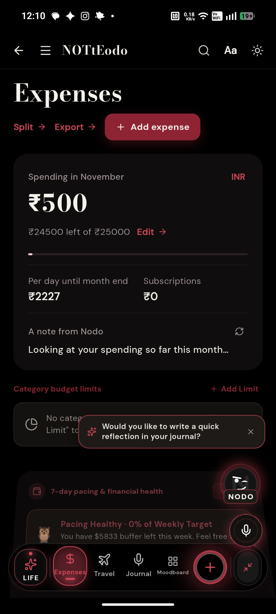
  &nbsp;
  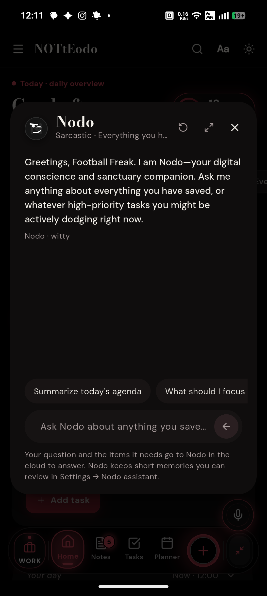
  &nbsp;
  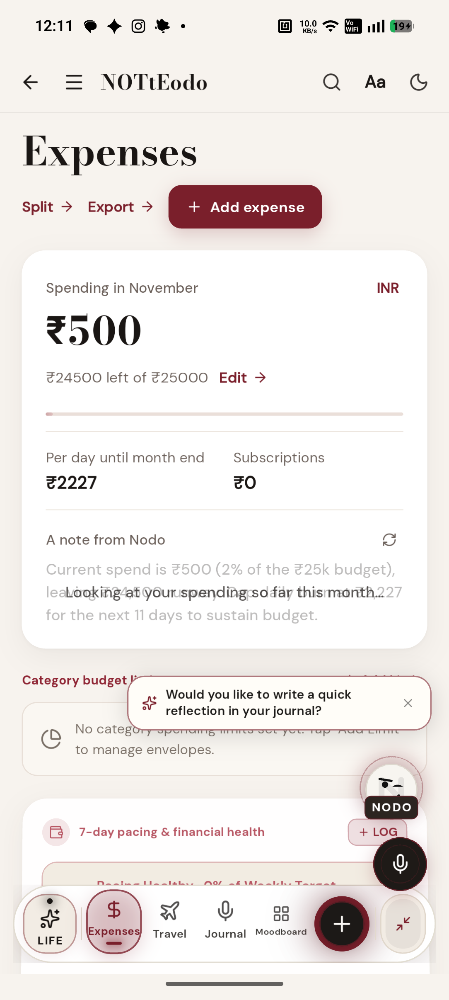
</p>

<br/>

# NOTtEodo

### *Notes · Tasks · Habits · Expenses · Wardrobe · Moodboards · Voice Memos · Focus Timer*
#### **Your Simple, Private, All-in-One Daily Organizer**

<p align="center">
  <em>A clean, private sanctuary for your notes, daily tasks, habits, spending, and focus — 100% free with no ads and no subscriptions.</em>
</p>

<!-- DYNAMIC BRAND SHIELDS (IVORY & OXBLOOD PALETTE · ZERO BLUE · ZERO GOLD · ZERO GREEN) -->
<p align="center">
  <a href="https://flutter.dev"></a>
  <a href="https://dart.dev"></a>
  <a href="#-the-notteodo-palette"></a>
  <a href="#-the-notteodo-palette"></a>
  <a href="#-on-device-notifications--signature-ribbon-monogram"></a>
  <a href="#-aesthetic-pinterest-homescreen-widgets"></a>
  <a href="https://github.com/Allen73737/NOTtEodo/actions"></a>
  <a href="#-license"></a>
</p>

<!-- REAL-TIME HIGHLIGHTS TICKER -->
<p align="center">
  <code>✦ 100% LOCAL-FIRST</code> &nbsp;•&nbsp;
  <code>🔄 DUAL BENTO &amp; SWISS EDITORIAL</code> &nbsp;•&nbsp;
  <code>🤖 SOVEREIGN NODO AI BRAIN</code> &nbsp;•&nbsp;
  <code>🎙️ NATIVE AUDIO STUDIO</code> &nbsp;•&nbsp;
  <code>⚡ OMNI-CAPTURE HUB</code> &nbsp;•&nbsp;
  <code>📳 3D FLIP MICRO-HAPTICS</code> &nbsp;•&nbsp;
  <code>⏰ EXACT ALARMS</code> &nbsp;•&nbsp;
  <code>🔒 ZERO SUBSCRIPTIONS</code>
</p>

<br/>

[Live App Preview](#-live-app-preview) •
[About NOTtEodo](#-about-notteodo) •
[Why NOTtEodo?](#-why-notteodo) •
[Dual Visual Architecture](#-dual-visual-architecture-bento--swiss-editorial) •
[Sovereign NODO AI Brain](#-sovereign-nodo-ai-brain-hybrid-intelligence) •
[Bento Notes & Knowledge Sanctuary](#-bento-notes--knowledge-sanctuary) •
[Tasks, Priorities & Swipe Scheduling](#-tasks-priorities--swipe-scheduling) •
[Master Planner & Agenda Calendar](#-master-planner--agenda-calendar) •
[Category Budget Limits & Envelopes](#-category-budget-limits--spending-envelopes) •
[Habit Streaks & 52-Week Heatmap](#-habit-streaks-flame-evolution--celestial-astrolabe) •
[Watchmaker Focus Dial](#-watchmaker-focus-dial--customizable-timer) •
[Wardrobe & Seasonal Outfit Planner](#-wardrobe--seasonal-outfit-planner) •
[Photo Moodboards & 3D Flip Cards](#-photo-moodboards--3d-interactive-flip-cards) •
[Native Audio Studio Engine](#-native-android-audio-studio-engine) •
[Sunday Weekly Executive Digest](#-sunday-weekly-executive-digest--retrospective) •
[Travel Spaces & Passports](#-travel-spaces--itinerary-passports) •
[On-Device Notifications & Monogram](#-on-device-notifications--signature-ribbon-monogram) •
[Admin AI Copilot (Architect)](#-sovereign-admin-ai-copilot-notteodo-architect) •
[Local-First Security & Cryptography](#-local-first-security--cryptographic-ledger) •
[120Hz Spring Dynamics](#-120hz-spring-dynamics--mid-flip-micro-haptics) •
[Homescreen Widgets](#-aesthetic-pinterest-homescreen-widgets) •
[Android System Integrations](#-android-system-level-integrations) •
[The Color Palette](#-the-notteodo-palette) •
[Quickstart Guide](#-quickstart-guide) •
[License](#-license)

<br/>


</div>

<br/>

## 📱 Live App Preview

<p align="center">
  <em>Authentic production screenshots captured natively on <strong>Nothing Phone (2a)</strong> running Android 16 (API 36).</em>
</p>

### 🍱 Signature Bento Card Architecture (The Face of NOTtEodo)

> *Tactile, depth-aware modular pods, streak flame indicators, 52-week consistency heatmaps, financial envelopes, and the Sovereign NODO AI assistant.*

<div align="center">
<table>
  <tr>
    <th align="center" width="25%">Bento Home (Dark)</th>
    <th align="center" width="25%">Bento Home (Light)</th>
    <th align="center" width="25%">Bento Notes (Dark)</th>
    <th align="center" width="25%">Bento Notes (Light)</th>
  </tr>
  <tr>
    <td align="center"></td>
    <td align="center"></td>
    <td align="center"></td>
    <td align="center">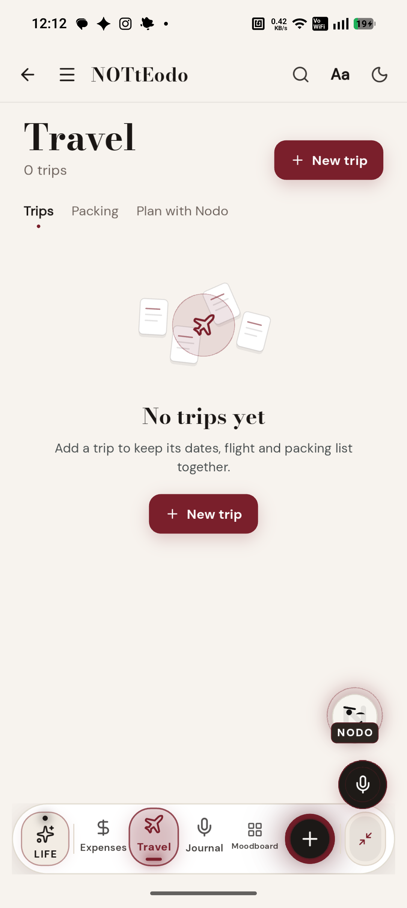</td>
  </tr>
  <tr>
    <th align="center" width="25%">Bento Tasks (Dark)</th>
    <th align="center" width="25%">Bento Tasks (Light)</th>
    <th align="center" width="25%">Bento Planner (Dark)</th>
    <th align="center" width="25%">Bento Planner (Light)</th>
  </tr>
  <tr>
    <td align="center"></td>
    <td align="center"></td>
    <td align="center"></td>
    <td align="center">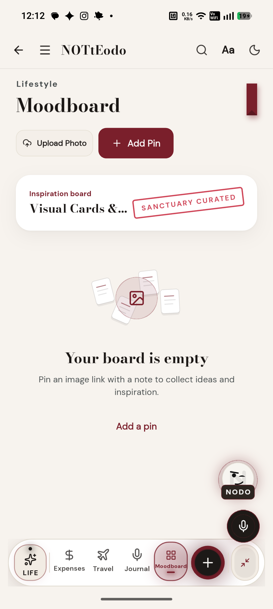</td>
  </tr>
  <tr>
    <th align="center" width="25%">Habits & 52-Week Heatmap (Dark)</th>
    <th align="center" width="25%">Habits & 52-Week Heatmap (Light)</th>
    <th align="center" width="25%">Expenses & Envelopes (Dark)</th>
    <th align="center" width="25%">Expenses & Envelopes (Light)</th>
  </tr>
  <tr>
    <td align="center"></td>
    <td align="center"></td>
    <td align="center">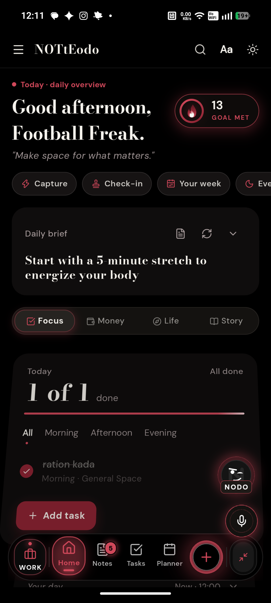</td>
    <td align="center"></td>
  </tr>
  <tr>
    <th align="center" width="25%">Quick Creation Dial (Dark)</th>
    <th align="center" width="25%">Quick Creation Dial (Light)</th>
    <th align="center" width="25%">Sovereign NODO AI (Dark)</th>
    <th align="center" width="25%">Sovereign NODO AI (Light)</th>
  </tr>
  <tr>
    <td align="center"></td>
    <td align="center"></td>
    <td align="center"></td>
    <td align="center"></td>
  </tr>
</table>
</div>

<br/>

### 🖋️ Swiss Editorial Architecture (Minimal Typographic View)

> *Words on paper. High-contrast typography and unadorned whitespace, toggled seamlessly via the `Aa` button.*

<div align="center">
<table>
  <tr>
    <th align="center" width="25%">Today (OLED Obsidian)</th>
    <th align="center" width="25%">Today (Ivory Canvas)</th>
    <th align="center" width="25%">Notebook (OLED Obsidian)</th>
    <th align="center" width="25%">Notebook (Ivory Canvas)</th>
  </tr>
  <tr>
    <td align="center"></td>
    <td align="center">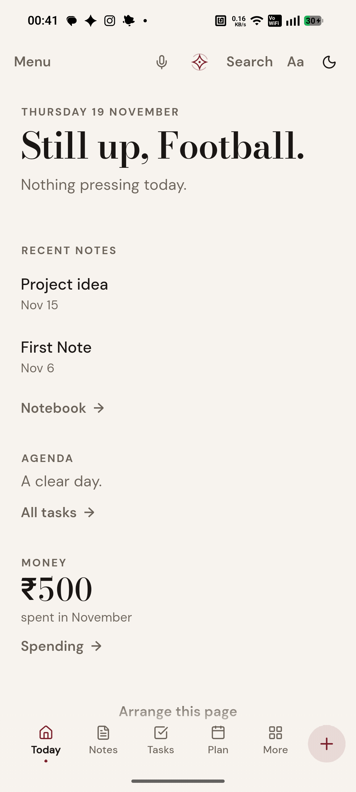</td>
    <td align="center"></td>
    <td align="center"></td>
  </tr>
  <tr>
    <th align="center" width="25%">Tasks & Agenda (Dark)</th>
    <th align="center" width="25%">Tasks & Agenda (Light)</th>
    <th align="center" width="25%">Planner (Dark)</th>
    <th align="center" width="25%">Planner (Light)</th>
  </tr>
  <tr>
    <td align="center">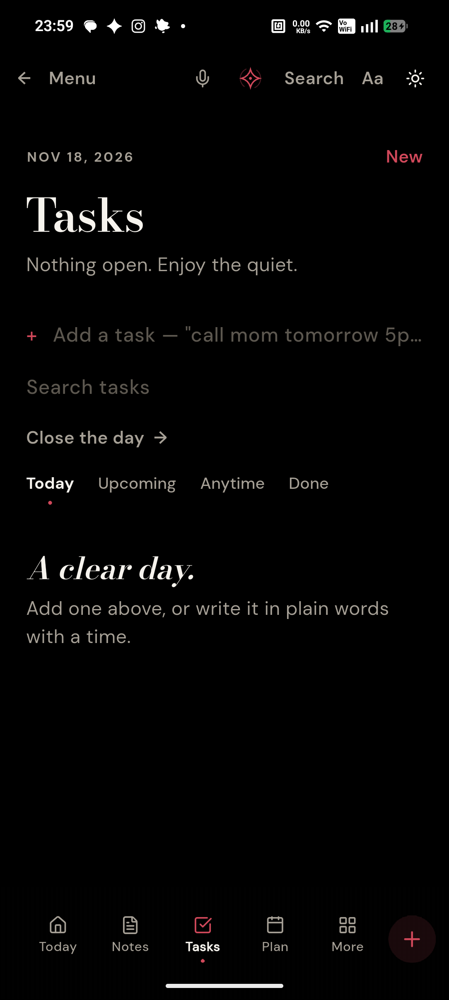</td>
    <td align="center">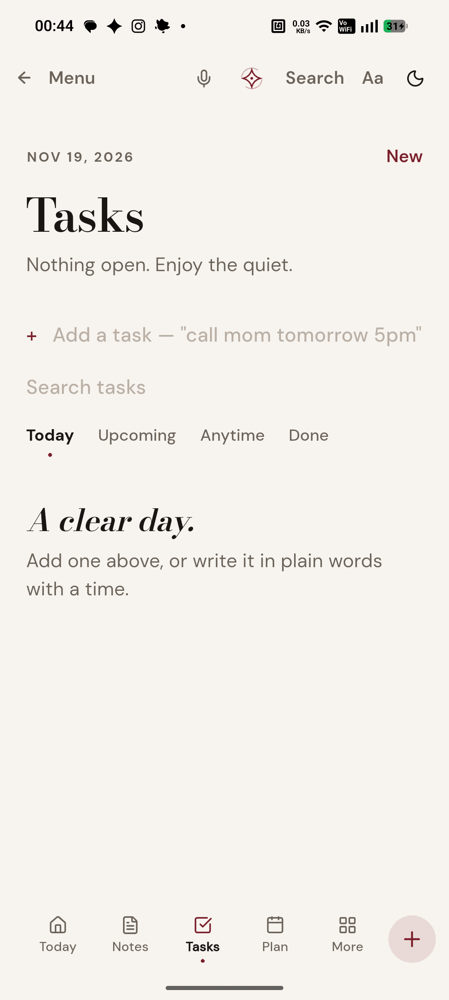</td>
    <td align="center"></td>
    <td align="center">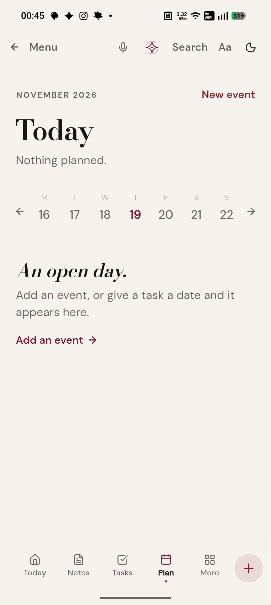</td>
  </tr>
  <tr>
    <th align="center" width="25%">Habits & Rituals (Dark)</th>
    <th align="center" width="25%">Habits & Rituals (Light)</th>
    <th align="center" width="25%">Expenses & Envelopes (Dark)</th>
    <th align="center" width="25%">Expenses & Envelopes (Light)</th>
  </tr>
  <tr>
    <td align="center">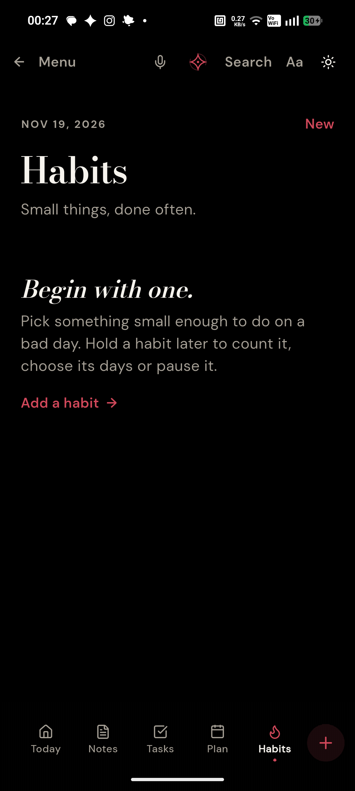</td>
    <td align="center"></td>
    <td align="center">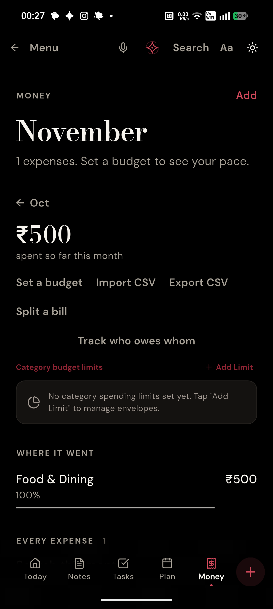</td>
    <td align="center"></td>
  </tr>
  <tr>
    <th align="center" colspan="2">Watchmaker Focus Dial (OLED Obsidian)</th>
    <th align="center" colspan="2">Watchmaker Focus Dial (Ivory Canvas)</th>
  </tr>
  <tr>
    <td align="center" colspan="2"></td>
    <td align="center" colspan="2">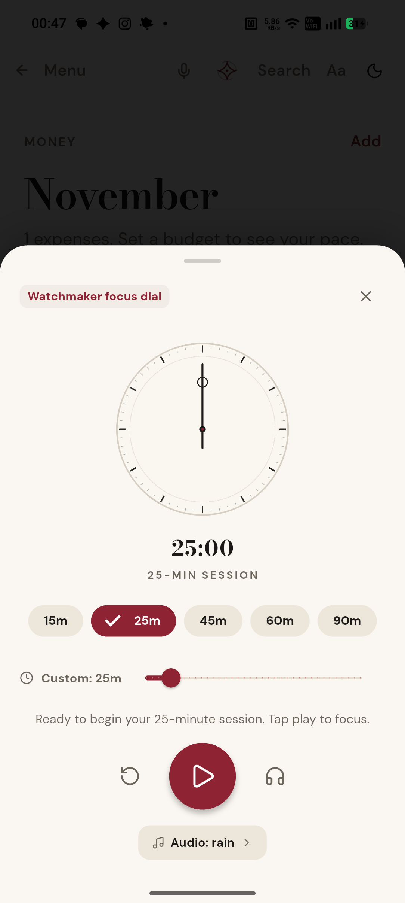</td>
  </tr>
</table>
</div>

<br/>

<div align="center">
  
</div>

<br/>

## 📖 About NOTtEodo

> *"Make space for what matters."*

**NOTtEodo** is a free, simple, and private life organizer built with Flutter and Dart. It combines your daily notes, to-do lists, habit tracker, personal spending, outfit planner, moodboards, voice notes, and focus timer into one clean app.

Whether you're jotting down quick ideas, organizing your day, splitting dinner bills with friends, planning what to wear, recording voice memos, or checking off habits right from your home screen, NOTtEodo helps you stay organized without feeling overwhelmed.

### Key Features

- 📝 **Notes & Fast Search:** Write quick notes with clean text, checklists, inline hashtags, markdown styling, and search through everything in seconds.
- 🎯 **Daily Tasks & Swipe Scheduling:** Reorder tasks with drag-and-drop, swipe right to complete, swipe left to schedule or bin, and receive intelligent reminders.
- 🔥 **Habit Tracker & 52-Week Heatmap:** Build daily routines and watch your streak flame evolve across a full 52-week annual consistency heatmap.
- 💰 **Category Budget Limits (Envelopes):** Set monthly spending caps per category, track visual burn-rate pacing bars, and split group expenses without an external app.
- 📊 **Sunday Weekly Executive Digest:** Automated Sunday retrospective modal aggregating weekly completed tasks, habit consistency velocity, and net spending totals.
- 👗 **Wardrobe Planner:** Plan outfits, save clothing items with photos, and organize your seasonal styles with fabric swatches.
- 🎨 **Photo Moodboards:** Collect inspiration and ideas on cards that flip over in 3D to reveal handwritten notes and tags.
- 🎙️ **Voice Notes & Waveform Scrubber:** Record lossless voice memos with clear sound, live audio visualization, and scrubbable playback.
- ⏱️ **Focus Timer:** A peaceful Pomodoro timer with animated Breguet horological hands and ambient binaural soundscapes.
- 📲 **Android System Integrations:** Android Share Target (`ACTION_SEND`), Quick Settings pull-down QS tile, launcher shortcuts, and themed Material You icons.
- 🔒 **Safe & Private:** Your notes and data stay on your phone with AES-256 GCM encryption, an emergency offline recovery key, and optional private cloud sync.

<br/>

<div align="center">
  
</div>

<br/>

---

<br/>

## 💡 Why NOTtEodo?

Modern productivity apps have become cluttered, bloated, and full of monthly paywalls:

| The Old Way | The NOTtEodo Way |
| :--- | :--- |
| **5 to 10 separate apps** (one for notes, one for to-dos, one for budget, one for habits) | **One simple sanctuary** where your daily life lives together cleanly |
| **Expensive monthly fees** just to use basic features | **100% Free & Open Source** forever — no paywalls, no paid tiers, zero ads |
| **Apps that track and sell your data** to show you ads | **Offline-first & Private** — your data stays safely on your phone with strong AES-256 cipher encryption |
| **Cluttered, distracting screens** and loud notification spam | **Clean, calm design** with gentle Ivory & Oxblood colors, smooth animations, and peaceful reminders |
| **Locked into one look** that you can't change | **2 Beautiful Views** — switch anytime between tactile Bento cards and a clean Swiss editorial reading mode |

---

<br/>

<div align="center">

</div>

<br/>

## 🔄 Dual Visual Architecture: Bento & Swiss Editorial

NOTtEodo is built from the ground up on a dual-paradigm presentation engine. A single tap on the **`Aa`** switcher button anywhere in the app instantly transforms the viewport between two distinct aesthetic worlds:

<div align="center">
<table>
  <tr>
    <th align="center" width="50%">🍱 Bento Architecture (The Face of NOTtEodo)</th>
    <th align="center" width="50%">📰 Swiss Editorial (Minimal Print Mode)</th>
  </tr>
  <tr>
    <td align="center"></td>
    <td align="center"></td>
  </tr>
</table>
</div>

<br/>

<div align="center">

| Aesthetic Characteristic | 🍱 Bento Architecture (Cards Mode) | 📰 Swiss Editorial (Print Mode) |
| :--- | :--- | :--- |
| **Visual Metaphor** | Physical obsidian deck of cards with depth, chamfers, and tactile borders | Fine stationery, Kinfolk magazine, and Swiss editorial print |
| **Layout Philosophy** | High-contrast bento pods with tactile rounded containers | Flush typography on paper; no boxes, borders, or redundant pills |
| **Motion Physics** | **120Hz Spring Dynamics:** 0.975 tactile depression, 4.0px hover lift | **Calm Page Turns:** Gentle opacity dissolves and 3D card flips |
| **Moodboard Visuals** | 3D Polaroid flip cards with handwritten notes on the back | Interactive 3D flippable photo cards (`setEntry(3, 2, 0.001)`) |
| **Wardrobe Previews** | High-resolution garment grid with season & fabric swatches | Clean list rows with 52×52 rounded chamfer thumbnails on the outside |
| **Typography Hierarchy** | Large, legible `13.5–15sp` body text with DM Sans & Space Grotesk | High-fashion Bodoni Moda, literary Playfair Display, and DM Sans |
| **In-App Toast Alerts** | Animated floating bento card with pulsing mascot aura glow | Quiet, book-weight Swiss print card with hairline oxblood line |
| **Where to Switch** | Top App Bar, Hamburger Drawer, Settings, Admin Dashboard, and Sign-In Screen (`Aa` pill) | Top App Bar, Hamburger Drawer, Settings, Admin Dashboard, and Sign-In Screen (`Aa` pill) |

</div>

<br/>

<div align="center">
<table>
  <tr>
    <th align="center" width="33%">Bento Today (Ivory Canvas)</th>
    <th align="center" width="33%">Bento Notes (Ivory Canvas)</th>
    <th align="center" width="33%">Bento Dial (Ivory Canvas)</th>
  </tr>
  <tr>
    <td align="center"></td>
    <td align="center"></td>
    <td align="center"></td>
  </tr>
</table>
</div>

<br/>

---

<br/>

<div align="center">

</div>

<br/>

## 🤖 Sovereign NODO AI Brain: Hybrid Intelligence

NOTtEodo is accompanied by **NODO AI**, an on-device and cloud-hybrid sovereign intelligence companion engineered specifically for personal organization, memory retention, and proactive guidance:

<div align="center">
<table>
  <tr>
    <th align="center" width="50%">🤖 Sovereign NODO AI (Obsidian Dark)</th>
    <th align="center" width="50%">🤖 Sovereign NODO AI (Ivory Canvas)</th>
  </tr>
  <tr>
    <td align="center"></td>
    <td align="center"></td>
  </tr>
</table>
</div>

<br/>

### Core Architecture & Capabilities

- **🧠 Dual-Brain Engine (Offline Heuristics + Cloud Neural):**
  - **Offline Mode:** When disconnected from the network, NODO operates using an internal deterministic knowledge graph, keyword heuristics, and local rule-based inference.
  - **Cloud Neural Mode:** When connected, NODO utilizes serverless Supabase Edge Functions (`scoped-ai` and `ai-assist`) backed by Google Gemini models for deep reasoning, nuanced conversation, and complex synthesis.
- **💾 Long-Term Memory Ledger (`user_memories`):**
  - NODO continuously learns your unique lifestyle: your daily waking routines, frequent project codes, preferred spending thresholds, personal habits, and communication tone.
  - Memories are isolated with PostgreSQL Row-Level Security (RLS) policies per authenticated user account, ensuring zero cross-tenant data leaks.
- **⚡ Intent-to-Action Dispatcher:**
  - Conversational instructions directly execute within your app state without leaving the chat modal:
    - *"Add a task to review quarterly taxes next Tuesday"* $\rightarrow$ creates a prioritized task with an exact alarm reminder.
    - *"I just spent ₹650 on groceries"* $\rightarrow$ automatically logs a transaction into your Food & Dining budget envelope.
    - *"Note down our brainstorm about the new brand identity"* $\rightarrow$ drafts a rich markdown note with tags.
- **🦉 Calm Stoic Persona (Anti-Chatbot):**
  - NODO speaks with intentional brevity, high intellectual clarity, and philosophical warmth. It never uses verbose disclaimers, canned AI pleasantries, or fake emotional expressions.
- **🔮 Proactive Ambient Bubbles:**
  - The floating mascot pill on the Home screen displays contextual daily prompts (e.g., *"Good evening. Ready to write your evening reflection?"* or *"3 habits left today — keep the 12-day flame burning"*).
- **🔒 Absolute Privacy & Memory Sovereignty:**
  - Zero user data is ever sold to brokers or used for public AI model training.
  - Transparent in-app **"Curate Memories"** view allowing you to inspect, edit, or permanently delete individual stored memories with 1 tap.

<br/>

---

<br/>

<div align="center">

</div>

<br/>

## 📝 Bento Notes & Knowledge Sanctuary

Transform chaotic thoughts into structured, beautiful knowledge cards:

<div align="center">
<table>
  <tr>
    <th align="center" width="50%">📝 Bento Notes Grid (Obsidian Dark)</th>
    <th align="center" width="50%">📝 Bento Notes Grid (Ivory Canvas)</th>
  </tr>
  <tr>
    <td align="center"></td>
    <td align="center"></td>
  </tr>
</table>
</div>

<br/>

- **🍱 Modular Card Grid:** Dynamic masonry layout where notes adapt organically to their content length with smooth rounded borders and tactile depth.
- **✨ Full Markdown & Checklists:** Write freely with bold, italics, quote blocks, bullet lists, code syntax, and interactive checkboxes that cross off in real time.
- **🎙️ Embedded Voice Scrubber:** Attach lossless voice recordings directly inside any note and play them back with live visual audio waveform scrubbing.
- **🏷️ Instant Tagging & Fast Search:** Tag notes with inline `#hashtags` or color-coded badges; search thousands of words in milliseconds with zero lag.
- **📌 Pinned Cards & Soft Deletion:** Pin crucial notes to the top of your deck; deleted notes move to the Trash Sanctuary for 30 days before permanent purging.

<br/>

---

<br/>

<div align="center">

</div>

<br/>

## 🎯 Tasks, Priorities & Swipe Scheduling

Execute your day with friction-free task management designed around natural finger gestures:

<div align="center">
<table>
  <tr>
    <th align="center" width="50%">🎯 Bento Tasks (Obsidian Dark)</th>
    <th align="center" width="50%">🎯 Bento Tasks (Ivory Canvas)</th>
  </tr>
  <tr>
    <td align="center"></td>
    <td align="center"></td>
  </tr>
</table>
</div>

<br/>

- **🗂️ 4 Distinct Priority Pods:** Organize action items into **Urgent**, **High**, **Medium**, and **Low** pods highlighted with subtle oxblood badges.
- **👆 120Hz Gesture Swipe Controls:**
  - **Swipe Right $\rightarrow$** Complete task with an immediate celebratory haptic tick and micro-particle burst.
  - **Swipe Left $\leftarrow$** Reschedule to tomorrow, defer to a specific calendar block, or bin.
- **↕️ Drag & Drop Reordering:** Long-press any task card to lift it into 3D space with dynamic drop shadow elevation, dropping it cleanly into any priority tier.
- **⏰ Natural Language Scheduling:** Automatically parses phrases like *"Submit pitch tomorrow at 3pm"* to set exact alarm reminders.

<br/>

---

<br/>

<div align="center">

</div>

<br/>

## 🗓️ Master Planner & Agenda Calendar

Reclaim control over your time with an integrated daily timeline and time-blocking planner:

<div align="center">
<table>
  <tr>
    <th align="center" width="50%">🗓️ Bento Planner (Obsidian Dark)</th>
    <th align="center" width="50%">🗓️ Bento Planner (Ivory Canvas)</th>
  </tr>
  <tr>
    <td align="center"></td>
    <td align="center"></td>
  </tr>
</table>
</div>

<br/>

- **🌅 Diurnal Time-Blocking:** Breaks each 24-hour cycle into intentional phases: **Morning Focus**, **Afternoon Execution**, and **Evening Wind-down**.
- **📅 Unified Schedule Matrix:** Merges your scheduled to-dos, calendar events, focus intervals, and habit checkpoints into one cohesive vertical timeline.
- **⚡ Rapid Horizon Navigation:** Interactive horizontal date scrubber lets you slide effortlessly between days or jump to upcoming weeks in a tap.
- **⏳ Live Progress Needle:** Real-time hairline indicator showing your current position in the day relative to upcoming commitments.

<br/>

---

<br/>

<div align="center">

</div>

<br/>

## 💳 Category Budget Limits & Spending Envelopes

Master your personal cash flow with disciplined, visual budget limits built directly into the Expenses view:

<div align="center">
<table>
  <tr>
    <th align="center" width="50%">💳 Bento Spending Envelopes (Dark)</th>
    <th align="center" width="50%">💳 Bento Spending Envelopes (Light)</th>
  </tr>
  <tr>
    <td align="center"></td>
    <td align="center"></td>
  </tr>
</table>
</div>

<div align="center">

| Feature | How It Works | Practical Benefit |
| :--- | :--- | :--- |
| **🏷️ Category Envelopes** | Assign custom spending limits for every category (Food &amp; Dining, Transit, Shopping, Utilities, Travel) | Visual, envelope-style budgeting preventing overspending in key areas |
| **📊 Real-Time Pacing Bars** | Smooth animated burn-rate progress bars indicating percentage of budget consumed | Instantly see whether you are on track or nearing a threshold |
| **⚠️ Over-Budget Safety Shield** | Visual color transition into deep oxblood when an envelope exceeds 100% | Never be caught off-guard by runaway discretionary spending |
| **👥 Group Expense Splitter** | Split dinner bills, shared rentals, and groceries among contacts with computed settlements | Eliminates separate bill-splitting apps while keeping spending records local |

</div>

---

<br/>

<div align="center">

</div>

<br/>

## 🌅 Sunday Weekly Executive Digest & Retrospective

Every Sunday, NOTtEodo greets you with a calm executive retrospective designed to synthesize your week's accomplishments and set clear intentions for the week ahead:

- **Weekly Accomplishment Velocity:** Calculates the total volume of completed to-do tasks and tasks carried over.
- **Habit Consistency Rate:** Highlights streak milestones and week-over-week habit check-in percentages.
- **Net Spending Summary:** Summarizes total cash outflows compared against your weekly budget targets.
- **Intentional Reflection Modal:** Prompts you to record a short mindful reflection before starting Monday morning with a clean slate.

---

<br/>

<div align="center">

</div>

<br/>

## 🔔 On-Device Notifications & Signature Ribbon Monogram

NOTtEodo features a custom-engineered, battery-optimized Android notification architecture powered by Android exact alarms and a mathematically traced brand vector monogram:

<div align="center">
  
</div>

<br/>

<div align="center">

| Component | Visual & Interactive Character | Technical Implementation |
| :--- | :--- | :--- |
| **✨ Signature Ribbon 'N' Monogram** | Crisp, resolution-independent dual-loop calligraphy vector mark rendered across status bar, lockscreen, and notification headers | Android VectorDrawable in `ic_stat_notteodo.xml` derived from `NotteodoMonogramGeometry` |
| **🔥 Dynamic Mascot Large Icon** | 160×160 Tuscan obsidian squircle with oxblood accent border and contextual emoji badge (`🔥` streak, `⚡` focus, `🌅` morning, `🦉` Architect) | Android native `createAppLogoLargeIcon()` in `NotificationReceiver.kt` with memory-safe downsampling |
| **⚡ 1-Tap Shade Actions** | Direct action buttons inside the Android shade: `"✨ Check In"` to save daily streak, `"⚡ Focus 25m"` to launch timer, or `"✍️ Quick Note"` | Intent extras dispatched directly into Flutter via MethodChannels |
| **⏳ Depleting Progress Line** | Smooth dual-gradient countdown bar along the bottom edge showing exact remaining notification lifetime | Reactive `AnimationController` binding (`widget.lifeController`) |
| **⏰ 3-Hour Exact Alarm Cadence** | Intelligent daytime cadence (every 3h between 09:30 and 21:30) with automatic legacy migration | `USE_EXACT_ALARM` + `setExactAndAllowWhileIdle` in Kotlin `ReminderScheduler.kt` |
| **🛡️ System Doze Immunity** | Bypasses aggressive battery optimization and deep sleep while respecting custom quiet hours | Verified across Android 12, 13, 14, and Nothing OS |

</div>

---

<br/>

<div align="center">

</div>

<br/>

## 🦉 Sovereign Admin AI Copilot: NOTtEodo Architect

Built directly into the Admin Dashboard, **NOTtEodo ARCHITECT** is an on-device, sovereign administrative intelligence copilot designed to assist system curators with telemetry, diagnostics, and data operations:

<div align="center">
  
</div>

<br/>

- **Live System Health Audits:** Real-time analysis of SQLite cipher state, notification queue depth, test pass status, and memory integrity with zero dummy data.
- **One-Tap Diagnostic Triggers:**
  - `⚡ Run Full Health Audit`: Validates database integrity and reports instant status.
  - `🔔 Fire Test Notification`: Instantly sends an on-device broadcast notification to verify sound, icon, and actions.
  - `📊 Audit Record Counts`: Inspects live row counts across Notes, Tasks, Habits, Expenses, and Wardrobe.
  - `🛡️ Error Log Forensics`: Scans internal logs for uncaught exceptions, R8 warnings, or memory pressure.
- **Server-Side Lockdown:** Secured via `public.app_admins` table and PostgreSQL Row-Level Security (RLS) policies.

---

<br/>

<div align="center">

</div>

<br/>

## ⏱️ Watchmaker Focus Dial & Master Creation Studio

Inspired by high Swiss horology (Abraham-Louis Breguet) and tactile mechanics, NOTtEodo provides an intentional, meditative dial interface for both focus timing and rapid item creation:

<div align="center">
<table>
  <tr>
    <th align="center" width="50%">⏱️ Master Bento Dial (Obsidian Dark)</th>
    <th align="center" width="50%">⏱️ Master Bento Dial (Ivory Canvas)</th>
  </tr>
  <tr>
    <td align="center"></td>
    <td align="center"></td>
  </tr>
</table>
</div>

<br/>

- **⚙️ Master Quick Creation Dial:** Tapping the central dial button unfolds an obsidian radial menu to instantly launch a Focus Session, record a Lossless Voice Memo, draft a Quick Note, capture a Priority Task, log an Expense to an envelope, or record an Outfit.
- **🕰️ Animated Breguet Horological Hands:** Real-time ticking Breguet balance hands sweeping smoothly over an ivory chapter ring with Tuscan obsidian and oxblood styling (strictly zero yellow/gold).
- **⏱️ Customizable Pomodoro Durations:**
  - One-tap quick presets: **15 min**, **25 min** *(Classic Pomodoro)*, **45 min**, **60 min**, and **90 min** *(Ultradian Deep Work Rhythm)*.
  - Smooth custom duration slider spanning **5 min to 180 min** with tactile tick haptics.
- **🎵 Generative Ambient Soundscapes:** Built-in offline focus audio including *Deep Sanctuary Rain*, *Tibetan Singing Bowl*, *Forest Rain*, and *Silent Sanctuary*.
- **📱 Persistent System Notification Controls:** Real-time lockscreen notification with countdown timer and 1-tap Pause/Resume/Stop playback actions.

<br/>

---

<br/>

<div align="center">

</div>

<br/>

## 👗 Wardrobe & Seasonal Outfit Planner

Curate your personal aesthetic and eliminate morning decision fatigue with an integrated capsule wardrobe manager:

- **🧥 Garment Inventory & Season Swatches:** Catalog clothing items across *Spring*, *Summer*, *Autumn*, and *Winter* with fabric tags (e.g., Linen, Heavy Wool, Silk, Raw Denim) and custom palette swatches.
- **✨ Visual Outfit Builder:** Assemble complete daily ensembles pairing tops, bottoms, outerwear, footwear, and accessories.
- **🌤️ Ambient Weather Alignment:** Recommends appropriate layers and outfits based on real-time temperature conditions and seasonal tags.
- **🧺 Wear Frequency & Laundry Tracking:** Monitor cost-per-wear metrics and mark garments in rotation or resting.

<br/>

---

<br/>

<div align="center">

</div>

<br/>

## 🖼️ Photo Moodboards & 3D Interactive Flip Cards

Organize visual inspirations, architectural references, and personal aesthetic boards:

- **📸 3D Flip Card Architecture:** Every moodboard photo card exists in physical perspective space. Tap any card to trigger a smooth 3D flip (`setEntry(3, 2, 0.001)`) revealing handwritten captions, source links, and tag annotations on the reverse side.
- **📳 Mid-Flip Micro-Haptics:** Senses the exact $90^\circ$ midpoint of the card's rotation to trigger a subtle physical tactile "snap" in your hand.
- **🏷️ Board Collections & Themes:** Group inspirations into custom thematic galleries (*Interior Architecture*, *Typography Studies*, *Travel Dreamscapes*, *Style Book*).
- **🔒 Full Resolution Offline Storage:** Images are securely stored locally on your device with hardware-backed encryption.

<br/>

---

<br/>

<div align="center">

</div>

<br/>

## 🎙️ Native Android Audio Studio Engine

Voice memos in NOTtEodo are powered by a native Android audio engine engineered directly in `MainActivity.kt` and `voice_studio_modal.dart` without external UI popups or cloud dependencies:

- **Hardware AAC Recording:** High-fidelity audio encoding to `.m4a` files using Android's native `MediaRecorder` with adaptive bitrates.
- **Built-in Waveform Scrubber Playback:** Listen back to voice notes directly inside notes with interactive seek scrubbing and live audio visualization.
- **Background Speech-to-Text:** On-device voice transcription via Android `SpeechRecognizer` running quietly in the background with **ZERO intrusive Google UI popups or dialogs**.
- **1-Tap Workflow Conversion:** Instantly convert voice memos into structured notes, daily tasks, or logged expenses with transcription copy and local audio playback controls.

<br/>

---

<br/>

<div align="center">

</div>

<br/>

## 🌌 Habit Streaks, Flame Evolution & Celestial Astrolabe

Build compounding daily momentum through continuous activity tracking and collectible milestone achievements:

<div align="center">
<table>
  <tr>
    <th align="center" width="50%">🔥 52-Week Habit Heatmap (Obsidian Dark)</th>
    <th align="center" width="50%">🔥 52-Week Habit Heatmap (Ivory Canvas)</th>
  </tr>
  <tr>
    <td align="center"></td>
    <td align="center"></td>
  </tr>
</table>
</div>

<br/>

- **🔥 52-Week Full-Year Heatmap:** Comprehensive 365-day continuous activity matrix displaying real-time daily consistency, inspired by GitHub commit graphs.
- **🕯️ Streak Flame Evolution:** 5 progressive flame tiers celebrating long-term discipline:
  - *Tier 1: Spark of Inception* (1–6 Days)
  - *Tier 2: Steady Hearth Flame* (7–20 Days)
  - *Tier 3: Roaring Forge Flame* (21–49 Days)
  - *Tier 4: Astral Plasma Flame* (50–99 Days)
  - *Tier 5: Immortal Supernova Flame* (100+ Days)
- **🏺 Curator's Cabinet:** 8 collectible antique horological milestone trophies (*Kindling Spark*, *Brass Lantern*, *Sacred Hearth*, *Supernova Corona*, *Golden Phoenix*, *Watchmaker Apprentice*, *Master Horologist*, *Vault Guardian*).
- **🌙 Evening Zen Review:** Mindful daily shutdown ritual dialog (`EveningZenReviewDialog`) discoverable 24/7 across Home, Momentum, and Profile, sealing the day with an animated wax seal stamp (`WaxSealStamp`).

---

<br/>

<div align="center">

</div>

<br/>

## ✈️ Travel Spaces & Itinerary Passports

Plan journeys, coordinate packing essentials, and split adventure expenses with clean, travel-ready cards:

- **Perforated Airmail Ticket Stubs:** Authentic travel cards displaying departure countdowns, destination airport codes (`CDG ✈ HND`), and flight numbers.
- **Interactive Packing Matrices:** Categorized checklist lanes for *Essentials*, *Clothing*, *Electronics*, and *Toiletries* with completion tracking.
- **Shared Journey Spending:** Log travel disbursements and compute instant group debt settlements without switching to an external splitter.
- **📄 High-Fidelity Dossier Exports:** Generate and export printable travel itineraries and dossiers formatted in crisp PDF or clean HTML.

---

<br/>

<div align="center">

</div>

<br/>

## 🔒 Local-First Security & Cryptographic Ledger

Your personal sanctuary belongs exclusively to you. NOTtEodo operates with an offline-first architecture designed to withstand zero network connectivity:

- **Military-Grade AES-256 GCM:** Database files and secure tokens encrypted at rest via hardware-backed Android Keystore and iOS Keychain.
- **Zero Third-Party SDKs:** No Google Analytics, no Facebook SDK, no advertising identifiers, and no telemetry tracking your thoughts.
- **Biometric App Lock:** Optional fingerprint and Face Unlock biometric authentication via `local_auth`.
- **Master Recovery Key (Offline Sovereignty):** Crockford Base32 16-character emergency key (`NOTT-XXXX-XXXX-XXXX`) protected by salted SHA-256 and Android Keystore hardware storage. Eliminates lockouts for users with placeholder or inaccessible email addresses.
- **Zero-Data-Loss Cloud PIN Recovery:** Forgotten device PINs can be recovered by authenticating with cloud account credentials, safely wiping the local PIN, and immediately re-syncing 100% of data from Supabase.
- **Complete Data Portability & Rescue:** Instant 1-tap "Export Sanctuary Backup (JSON)", "Continue in Offline Mode", and "Permanently Erase All Data" with verification safeguards.

---

<br/>

<div align="center">

</div>

<br/>

## 📳 120Hz Spring Dynamics & Mid-Flip Micro-Haptics

Every interaction inside NOTtEodo is calibrated to feel physical, responsive, and grounded:

<div align="center">
  
</div>

<br/>

- **Tactile Depression Dynamics:** Cards respond instantly to touch with a calibrated `0.975` scale depression and `4.0px` hover lift.
- **Mid-Flip Micro-Haptics:** Real-time perspective animation listener tracking the exact $90^\circ$ midpoint ($t = 0.5$) of card rotations, delivering an authentic physical "card snap" tactile click in your palm.
- **Hardware Haptic Synthesis:** Subtle `HapticFeedback.selectionClick()` on slider ticks and `lightImpact()` when completing daily priorities.

---

<br/>

<div align="center">

</div>

<br/>

## 📌 Aesthetic Pinterest Homescreen Widgets

Bring the calm, aesthetic vibe of NOTtEodo directly onto your phone's home screen. With our built-in **Interactive Widget Studio**, you can preview, customize, and pin 8 distinctive home screen widgets on Android and iOS in both **Bento** and **Swiss Editorial** styles:

<div align="center">

| Widget Type | What it Shows | Aesthetic Details |
| :--- | :--- | :--- |
| 📝 **Sticky Note & Memo** | Latest thought, pinned note excerpt, or quote | Textured paper card, serrated washi tape strip, editorial Bodoni title |
| ✅ **Daily Ritual Checklist** | Top tasks due today + habit streak progress | Checkbox progress counter (`4/5 DONE`), strikethrough typography |
| 🖼️ **Polaroid Inspiration Pin** | Highlighted image from your moodboards | Authentic Polaroid white photo border with handwritten italic caption |
| 👗 **Outfit of the Day** | Current season look, silhouettes, and fabric swatches | Clean editorial layout, temperature indicator, and palette dots |
| 💰 **Treasury & Budget Meter** | Monthly spend pacing and today's outflows | Minimal cash meter, currency symbol, and burn rate progress bar |
| 🎙️ **Voice Note Memo** | Quick voice note title, audio waveform, and duration | Retro cassette tape reels with red recording indicator |
| ✈️ **Travel Boarding Pass** | Next trip destination and departure countdown | Perforated airline ticket border with airport code route (`CDG ✈ HND`) |
| ⏱️ **Focus Clock & Quote** | Live system time + rotating daily reflection prompt | Classic horological dial with clean typography |

</div>

> [!TIP]
> Open the in-app **Widget Studio** anytime from **Settings $\rightarrow$ Homescreen Widget Studio** to preview paper styles, choose washi tape colors, and toggle between Bento and Swiss Editorial widget styling.

---

<br/>

<div align="center">

</div>

<br/>

## 📱 Android System-Level Integrations

NOTtEodo is engineered as a first-class citizen on modern Android devices, leveraging system capabilities for effortless access:

<div align="center">

| System Feature | Technical Implementation | Practical Daily Benefit |
| :--- | :--- | :--- |
| **📥 Android Share Target** | Registered in `AndroidManifest.xml` (`ACTION_SEND`, `ACTION_SEND_MULTIPLE`) via `SharedContentDialog` | Share web links, articles, text snippets, and photos from any browser or app directly into NOTtEodo to create a Note, Task, or Moodboard card. |
| **🎛️ Quick Settings QS Pull-down Tile** | Android `QuickCaptureTileService` registered in the notification shade | Pull down your Android quick settings shade from any app or lockscreen to instantly tap "Quick Capture" and record ideas in seconds. |
| **⚡ Launcher Quick Shortcuts** | Declared in `shortcuts.xml` and wired via deep links (`notteodo://shortcut/*`) | Long-press the NOTtEodo icon on your Android home screen to immediately trigger **Quick Capture**, **Voice Memo**, or **Focus Timer** without waiting. |
| **🎨 Themed Material You Icon** | Monochromatic vector squircle defined in `mipmap-anydpi-v26/ic_launcher.xml` | Automatically adapts to your Android 13+ wallpaper dynamic color palette when system "Themed Icons" are enabled. |
| **📳 Precision Micro-Haptics** | Native haptic pulses (`HapticFeedback.selectionClick()` & `lightImpact()`) | Delivers tactile feedback when completing tasks, tuning dials, and flipping 3D Polaroid moodboards. |
| **📅 Native Calendar Integration** | Multi-tier Android `CalendarContract` intent insertion | Adds events and reminders directly into Google Calendar with start/end timestamps and descriptions prefilled. |

</div>

---

<br/>

<div align="center">

</div>

<br/>

## 🎨 The NOTtEodo Palette

NOTtEodo's visual design is strictly free of corporate blues, harsh cyans, bright greens, and loud yellows or golds. It transitions seamlessly between **Ivory Canvas** (`#F7F3EE`) for daylight clarity and **Pure Pitch Black OLED** (`#000000`) with obsidian surfaces for nighttime focus, accented by rich **Deep Oxblood** (`#7A1F2B`), **Rosewood Oxblood** (`#B5505E`), and **Oxblood Blush** (`#E2B6BB`).

<div align="center">
  
</div>

<br/>

<div align="center">

| Color Token | Hex Code | Visual Character & App Role |
| :--- | :---: | :--- |
| `AppColors.darkBackground` | `#000000` | **Pitch Black OLED:** True 100% black pixels for battery saving and night comfort |
| `AppColors.darkSurfaceHigh` | `#0A0A0A` | **Obsidian Charcoal:** High-contrast solid dark surfaces for bento cards |
| `AppColors.darkBorder` | `#1E1E1E` | **Obsidian Hairline:** Subtle, crisp card borders in dark mode |
| `AppColors.darkTextPrimary` | `#F6F3ED` | **Crisp Linen White:** High-contrast primary text on pitch black |
| `AppColors.darkTextSecondary` | `#A89C9C` | **Warm Muted Subtext:** Balanced secondary typography for metadata |
| `AppColors.background` | `#F7F3EE` | **Ivory Canvas:** Warm, paper-like ivory foundation for light mode |
| `AppColors.surfaceContainer` | `#EFE8E1` | **Ivory Fill Base:** Elevated surfaces and cards in daylight mode |
| `AppColors.onSurface` | `#1D1C15` | **Warm Charcoal Ink:** Editorial typography for daylight reading |
| `AppColors.secondary` | `#7A1F2B` | **Deep Oxblood:** Primary buttons, active tabs, completed checkmarks, and brand accents |
| `AppColors.secondaryContainer` | `#B5505E` | **Rosewood Oxblood:** Secondary tonal badges, chips, and container fills |
| `AppColors.goldLight` | `#E2B6BB` | **Oxblood Blush:** Soft, high-contrast accent highlight on dark surfaces |
| `AppColors.themeTasks` | `#7A1F2B` | **Deep Oxblood:** Task deadlines, priority badges, and active schedules |
| `AppColors.themePlanner` | `#7A1F2B` | **Deep Oxblood:** Habit streaks, calm productivity lanes, and calendar milestones |
| `AppColors.themeExpenses` | `#9B3B47` | **Muted Oxblood Clay:** Expense categories, budget meters, and treasury balances |
| `AppColors.themeJournal` | `#B5505E` | **Rosewood Oxblood:** Personal journal entries and mood reflections |
| `AppColors.themeTravel` | `#9E7B56` | **Antique Warm Bronze:** Travel passports, departure cards, and packing lists |

</div>

---

<br/>

<div align="center">

</div>

<br/>

## 🛠️ Quickstart Guide

### Prerequisites
- **Flutter SDK:** `3.24` or newer ([Install Flutter](https://docs.flutter.dev/get-started/install))
- **Dart SDK:** `3.5` or newer
- **Browser, Android Device / Emulator, or iOS Simulator**

### 1. Clone & Setup
```bash
# Clone the repository
git clone https://github.com/Allen73737/NOTtEodo.git
cd NOTtEodo

# Configure your local environment variables
cp .env.example .env
```

### 2. Run the App
```bash
# Move to the Flutter frontend directory
cd frontend

# Install dependencies
flutter pub get

# Run on Chrome / Web
flutter run -d chrome

# Or run on Android / iOS
flutter run -d android
flutter run -d ios
```

### 3. Verification & Testing
```bash
# Run strict static code analysis (0 errors, 0 warnings, 0 infos)
dart analyze lib test --fatal-infos

# Run the complete test suite (287 passing tests across 24 suites, 100% pass rate)
flutter test
```

---

<br/>

<div align="center">

</div>

<br/>

## ⚖️ License

Distributed under the **MIT License**. See [LICENSE](LICENSE) for full details.

<br/>

<div align="center">

```
  ✦ · ✦ · ✦
  "Make space for what matters."
  NOTtEodo · Notes · Tasks · Habits · Expenses · Wardrobe · Moodboards · Life
```


</div>
