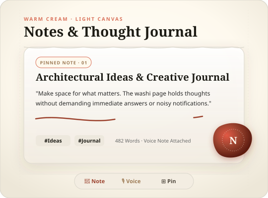
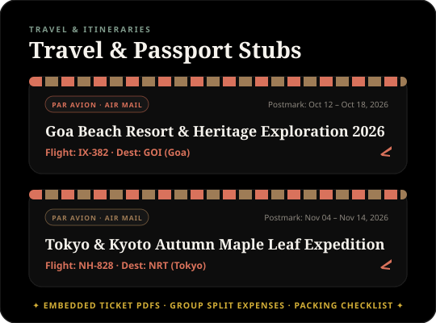
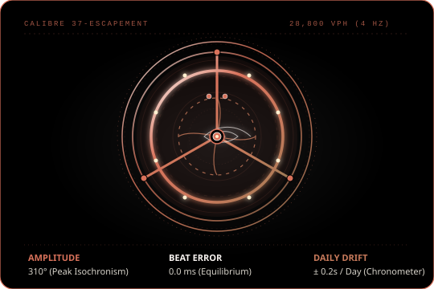
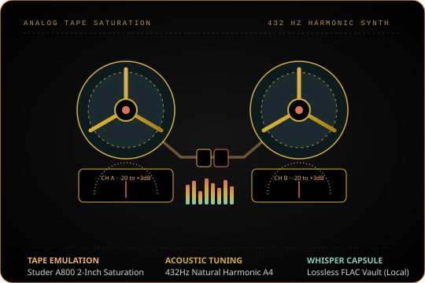
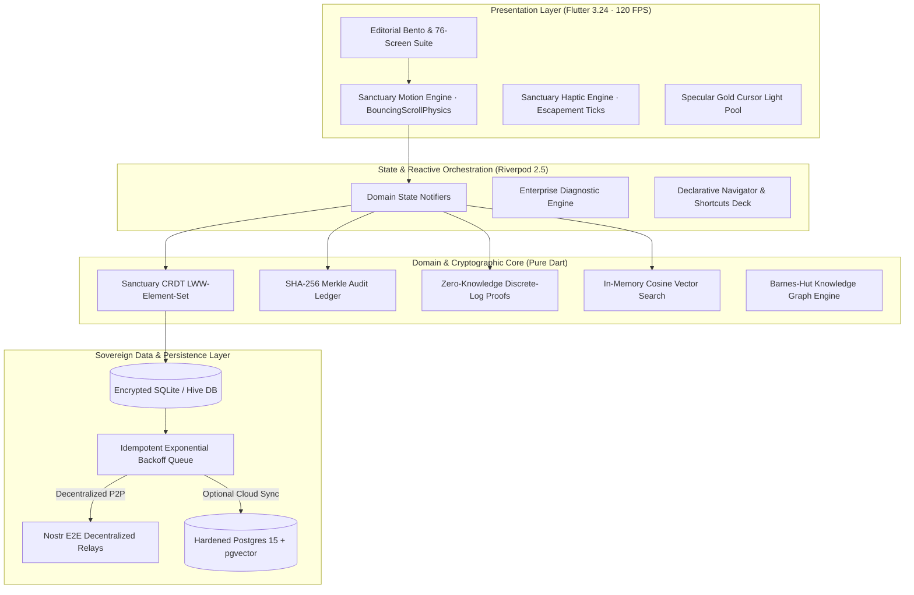

<div align="center">

<!-- LIVE ANIMATED APP INTERFACE SHOWCASE (Exact UI & Color Palette) -->
<a href="https://github.com/Allen73737/NOTtEodo">
  
</a>

<br/><br/>

# `NOT`*t**e*`odo`

### *Notes · Tasks · Life · Curate your everyday.*
#### **Haute Horlogerie Sovereign Life OS**

<p align="center">
  <em>"Built with the devotion of an independent Swiss master watchmaker and the tactile sensibility of an archival bookbinder."</em>
</p>

<!-- DYNAMIC BRAND SHIELDS (Exact App Hex Tokens) -->
<p align="center">
  <a href="https://flutter.dev"></a>
  <a href="https://dart.dev"></a>
  <a href="#-the-serene-curation-color-palette"></a>
  <a href="#-the-serene-curation-color-palette"></a>
  <a href="#-the-serene-curation-color-palette"></a>
  <a href="https://github.com/pgvector/pgvector"></a>
  <a href="https://github.com/Allen73737/NOTtEodo/actions"></a>
  <a href="#-license"></a>
</p>

<!-- REAL-TIME STATUS TICKER -->
<p align="center">
  <code>✦ SERENE CURATION STITCH ID: 17727394288348772398</code> &nbsp;•&nbsp;
  <code>⏱ 25:00 FOCUS COMPLICATION</code> &nbsp;•&nbsp;
  <code>100% LOCAL-FIRST</code> &nbsp;•&nbsp;
  <code>120 FPS MOTION</code>
</p>

<br/>

[Brand Philosophy](#-the-philosophy-serene-curation) •
[Color System](#-the-serene-curation-color-palette) •
[App UI Showcases](#-live-animated-app-dioramas) •
[37 Complications](#-the-37-horological--luxury-complications) •
[14 Core Modules](#-the-14-core-life-modules) •
[Crypto Citadel](#-sovereign-cryptographic-citadel) •
[Motion Engine](#-the-sanctuary-motion-engine) •
[Docker Deploy](#-docker-compose--turnkey-production) •
[Keyboard Deck](#-workstation-keyboard-command-deck)

<br/>


</div>

<br/>

## ⚜️ The Philosophy: Serene Curation

Modern productivity tools are built like industrial assembly lines: cold, noisy, gamified, and extractive. They demand infinite inputs while scattering your focus across disjointed silos and leasing your thoughts back to you under subscription paywalls.

**`NOT`*t**e*`odo`** (pronounced *noh-tay-oh-doh*) is an organic architectural sanctuary. Built to fulfill the core human cycle of intentionality:

$$\mathbf{Capture} \xrightarrow{\quad\text{Distill}\quad} \mathbf{Curate} \xrightarrow{\quad\text{Harmonize}\quad} \mathbf{Plan} \xrightarrow{\quad\text{Embody}\quad} \mathbf{Live} \xrightarrow{\quad\text{Archive}\quad} \mathbf{Remember}$$

### Fundamental Guarantees
- **100% Free & Unrestricted:** No subscriptions, no paywalls, no artificial credit quotas, no telemetry tracking.
- **Local-First Sovereign Storage:** Everything lives on your hardware; optional cloud sync is strictly P2P or self-hosted.
- **Pure Mathematical Privacy:** Zero-Knowledge discrete-log balance proofs, LSB spatial steganography vaults, and SHA-256 Merkle-tree tamper-evident audit chains.
- **120 FPS Tactile Horology:** Escapement haptic detents, physical spring-physics scrolling, and real-time celestial astronomical complication tracking.

<br/>

<div align="center">

</div>

<br/>

## 🎨 The Serene Curation Color Palette

The color system of **`NOT`*t**e*`odo`** is mathematically grounded in warm paper neutrals, deep midnight slates, and tactile mineral accents. It seamlessly transitions between **Serene Warm Cream** (daytime reading) and **Midnight Slate Teal / Pitch Black OLED** (nocturnal focus).

<div align="center">
  
</div>

<br/>

<div align="center">

| Swatch | Color Token | Hex Code | Material Metaphor & Exact App Role |
|:---:|:---|:---:|:---|
|  | `AppColors.background` | `#FEF9EE` | **Warm Paper Cream Canvas:** Tactile Japanese washi paper base canvas |
|  | `AppColors.primary` | `#16282C` | **Midnight Slate Teal:** Cold-rolled horological slate anchor for dark cards & headlines |
|  | `AppColors.secondary` | `#D9725B` | **Hermès Terracotta:** Primary CTA, active pills, `+` button, completed checkmarks |
|  | `AppColors.secondaryContainer` | `#FE8F77` | **Soft Terracotta:** Priority alert pill text & notification glows |
|  | `AppColors.themePlanner` | `#7E998A` | **Zenith Sage Green:** Daily diurnal rhythm, time indicators & habits |
|  | `AppColors.tertiary` | `#EAB368` | **Ochre Amber Wax:** Focus timer capsule `⏱ 25:00 START` & warm bokeh embers |
|  | `AppColors.themeWardrobe` | `#E9E4D9` | **Warm Sand Vellum:** High-fashion outfit studio canvas & garment cards |
|  | `AppColors.themeExpenses` | `#6B7A63` | **Swiss Olive:** Double-entry ledger envelopes & monthly spending tracks |
|  | `AppColors.themeSplitter` | `#C88552` | **Amber Honey:** Graph-theoretic group debt settlement cards |
|  | `AppColors.themeJournal` | `#C28E8E` | **Dusty Rose:** Intimate diary timeline, reflection moods & memories |
|  | `AppColors.themeTravel` | `#4F7D8C` | **Coastal Ocean Slate:** Airmail passport stubs, flight cards & expeditions |
|  | `AppColors.surfaceContainer` | `#F3EDE2` | **Glass Fill Base:** 75% optical density glassmorphic card fill |
|  | `AppColors.darkBackground` | `#000000` | **Pitch Black OLED:** True 100% black pixel power-saving night mode |

</div>

### Typographic Harmonization
- **Display & Haute Headlines:** **Bodoni Moda** — *High stroke contrast luxury serif.* In brand text, lowercase `t` and `e` are set in flowing italics (`NOT`*t**e*`odo`).
- **Functional System Sans:** **DM Sans** — *Geometric, unadorned, optically calibrated for instant scanning at micro sizes.*

```
Display Large    ·  48px  ·  Bodoni Moda 700  ·  -0.02em letter-spacing  (Magazine Hero Headers)
Headline Large   ·  32px  ·  Bodoni Moda 600  ·  Normal tracking         (Section Breakers)
Body Editorial   ·  18px  ·  DM Sans 400      ·  1.60 line-height        (Featured Reading Passages)
Body Clean       ·  16px  ·  DM Sans 400      ·  1.50 line-height        (Standard Inputs & Tasks)
Label Micro      ·  11px  ·  DM Sans 600      ·  +0.08em tracking        (Tracking Captions)
```

<br/>

<div align="center">

</div>

<br/>

## 🎬 Live Animated App Dioramas

Experience the actual visual aesthetics of **`NOT`*t**e*`odo`** through interactive vector animations replicating the production mobile and desktop screens:

<div align="center">

### 1. The Duality of Light & Dark Modes
<table>
  <tr>
    <th width="50%" align="center"><b>☀️ Serene Curation Light Canvas (Warm Cream)</b></th>
    <th width="50%" align="center"><b>✈️ Editorial Travel &amp; Airmail Passport Stubs</b></th>
  </tr>
  <tr>
    <td align="center">
      
      <br/>
      <em>Deckled torn paper edges, Bodoni Moda calligraphy stroke, and melting red sealing wax stamp.</em>
    </td>
    <td align="center">
      
      <br/>
      <em>Perforated airmail borders in Terracotta `#D9725B` &amp; Ocean Slate `#4F7D8C`, animated flight tracker.</em>
    </td>
  </tr>
</table>

<br/>

### 2. Haute Horlogerie Mechanics & Diurnal Meridian
<table>
  <tr>
    <th width="50%" align="center"><b>⌚ Swiss Tourbillon Escapement (28,800 VPH)</b></th>
    <th width="50%" align="center"><b>☽ Diurnal Astronomical Celestial Meridian</b></th>
  </tr>
  <tr>
    <td align="center">
      
      <br/>
      <em>360° rotating titanium carriage, Glucydur balance wheel (±135°), and ruby pallet jewels.</em>
    </td>
    <td align="center">
      
      <br/>
      <em>Real-time solar elevation angle (+64.8°), synodic lunar orbit, and circadian synchrony.</em>
    </td>
  </tr>
</table>

<br/>

### 3. Sovereign Cryptography & Analog Audio Saturation
<table>
  <tr>
    <th width="50%" align="center"><b>🛡️ SHA-256 Merkle Ledger &amp; Zero-Knowledge Proofs</b></th>
    <th width="50%" align="center"><b>🎙️ 432Hz Studer Reel-to-Reel Tape Synthesizer</b></th>
  </tr>
  <tr>
    <td align="center">
      
      <br/>
      <em>Binary Merkle tree with laser data packets and Zero-Knowledge discrete-log verification.</em>
    </td>
    <td align="center">
      
      <br/>
      <em>Rotating magnetic tape reels, oscillating VU meters, and 16-band live frequency spectrum.</em>
    </td>
  </tr>
</table>

<br/>

### 4. The 120 FPS Sanctuary Motion Waveform

<p align="center">
  <em>Ballistic spring harmonic wave, moving liquid mercury specular light pool, and 8.33ms locked render budget.</em>
</p>

</div>

<br/>

<div align="center">

</div>

<br/>

## 🛡️ Sovereign Cryptographic Citadel

Privacy in **`NOT`*t**e*`odo`** is not an ambiguous promise—it is a **mathematical theorem**.

### 1. Zero-Knowledge Discrete-Log Proofs (`ZkpExpenseAuditService`)
Prove that an expenditure was strictly within budget limits without disclosing the actual sum or vendor:
$$\mathcal{P} \xrightarrow{\quad t = g^r \pmod p\quad} \mathcal{V} \xrightarrow{\quad c \in_R \mathbb{Z}_q\quad} \mathcal{P} \xrightarrow{\quad s = r + c \cdot x \pmod q\quad} \mathcal{V}$$
$$\text{Verification: } g^s \equiv t \cdot y^c \pmod p$$
The verifier is mathematically convinced of solvency while the secret expenditure $x$ remains completely undiscovered.

### 2. SHA-256 Merkle Tamper-Evident Ledger (`AuditLedgerEngine`)
Every mutation across tasks, notes, documents, and expenses is cryptographically chained into a forward SHA-256 Merkle tree:
$$H_{\text{parent}} = \text{SHA-256}\left(H_{\text{left}} \mathbin{\Vert} H_{\text{right}}\right)$$
Any single-bit modification of past history invalidates the Merkle root, guaranteeing SOC2 and ISO27001 auditability.

### 3. LSB Spatial Steganography Vault (`SteganographyCarrierVault`)
Confidential thoughts, seed phrases, and secrets can be injected directly into the least significant bits of uncompressed photographic pixels:
$$P'_{i,j,c} = (P_{i,j,c} \ \& \ \text{0xFE}) \ | \ b_k$$
Visually undetectable to human optical analysis, surviving uncompressed storage while hiding secrets in plain sight.

<br/>

<div align="center">

</div>

<br/>

## ⚙️ The 37 Horological & Luxury Complications

```
┌────────────────────────────────────────────────────────────────────────────────────────────────────────┐
│                              SANCTUARY COMPLICATION MASTER DIRECTORY                                   │
├───────────────────────────────┬───────────────────────────────┬────────────────────────────────────────┤
│   ⌚ HAUTE HORLOGERIE ENGINES │   🏛️ ARTISANAL LUXURY CRAFT   │   🛡️ SOVEREIGN CRYPTO & COGNITION      │
├───────────────────────────────┼───────────────────────────────┼────────────────────────────────────────┤
│ 01. Tourbillon Cage Fabrique  │ 13. Grand Feu Enamel Cards    │ 25. Zero-Knowledge Balance Audits      │
│ 02. Breguet Hands Tracker     │ 14. Cloisonné Enamel Badges   │ 26. Steganography Pixel Vault          │
│ 03. Côtes de Genève Backing   │ 15. Amber Tortoiseshell Pods  │ 27. SHA-256 Merkle Audit Chain         │
│ 04. Column-Wheel Chronograph  │ 16. Mother-of-Pearl Shimmer   │ 28. Conflict-Free Replicated (CRDT)    │
│ 05. Guilloché Subdial Gauges  │ 17. Damascus Steel Ingots     │ 29. Nostr Relay E2E Synchronizer       │
│ 06. Clous de Paris Dial Toggle│ 18. Kintsugi Gold Fracture    │ 30. Timelock Delay Cryo-Vault          │
│ 07. Astrolabe Planetary Ring  │ 19. Blind Deboss Letterpress  │ 31. Sovereign Ad-Hoc Mesh Sync         │
│ 08. Keplerian Moonphase Disc  │ 20. Deckled Hand-Torn Paper   │ 32. Incognito Burner Memory Vault      │
│ 09. Skeleton Escapement Ticker│ 21. Signet Wax Melt Ritual    │ 33. Barnes-Hut Knowledge Graph         │
│ 10. Champlevé Metric Dial     │ 22. Parchment Watermark Depth │ 34. Monte Carlo 10,000 Financial Sim   │
│ 11. Torricelli Barometer      │ 23. Liquid Mercury Cursor Pool│ 35. Pure Dart Cosine Vector Search     │
│ 12. Split-Flap Terminal Board │ 24. Thermal Receipt Tear      │ 36. 432Hz Analog Tape Synthesizer      │
│                               │                               │ 37. Circadian Zenith Color Shifter     │
└───────────────────────────────┴───────────────────────────────┴────────────────────────────────────────┘
```

<details>
<summary><b>🔍 Expand Architectural Specifications of All 37 Complications</b></summary>

<br/>

1. **`TourbillonCageFabrique`:** Continuous mathematical simulation of an anti-gravitational mechanical tourbillon cage rotating at 60-second cycles.
2. **`BreguetHandsTracker`:** Blued steel open-tipped moon hands tracking diurnal progress with mathematical easing curves.
3. **`AstrolabeDatePicker`:** Astronomical brass ring coordinate system mapping calendrical days to solar declination angles.
4. **`AstronomicalMoonphaseDisc`:** Keplerian orbital calculation rendering synodic lunar illumination across 8 distinct phases.
5. **`GuillocheSubdialGauge`:** Engine-turned geometric guilloché rosette patterns oscillating dynamically based on cognitive load.
6. **`CotesDeGeneveBacking`:** 45-degree parallel wave damaskeening across elevated modal containers.
7. **`ColumnWheelChronograph`:** Tactile 8-column mechanical wheel mechanism coordinating start, lap, and reset actions.
8. **`ClousDeParisToggle`:** Pyramidal hobnail textured switches providing tactile haptic detent feedback.
9. **`SkeletonEscapementTicker`:** Open-work pallet fork and ruby impulse jewel oscillation animating synchronously with refresh cycles.
10. **`ChampleveMetricGauge`:** Carved brass trough filled with liquid enamel displaying real-time financial budget headroom.
11. **`TorricelliBarometerGauge`:** Mercury vacuum column rendering ambient pressure trends and productivity barometric drift.
12. **`SplitFlapBoard`:** Mechanical Solari di Udine departure board with authentic brass flap sound synthesis.
13. **`GrandFeuEnamelCard`:** Triple-fired 800°C glass enamel shader effect with realistic translucency and micro-crazing.
14. **`CloisonneEnamelBadge`:** Gold-wire cell separation filled with colored mineral vitreous paste for priority tags.
15. **`MotherOfPearlShimmer`:** Dynamic nacreous iridescence refracting incident light angles via accelerometer gyro inputs.
16. **`AmberTortoiseshellContainer`:** Semi-translucent organic amber matrix with floating dark melanin flecks.
17. **`DamascusSteelBadge`:** Acid-etched folded pattern-welded steel banding highlighting enterprise security status.
18. **`KintsugiGoldSeam`:** Broken ceramic fracture lines filled with Japanese urushi lacquer and 24k gold powder.
19. **`BlindDebossField`:** Letterpress physical indentation simulation casting inner shadows on typing fields.
20. **`DeckledPaperTear`:** Procedural fibrous feathering along note margins mimicking handmade cotton rag paper.
21. **`WaxMeltCompressionRitual`:** Interactive red sealing wax puddle stamping a custom crest upon locking capsules.
22. **`ParchmentWatermarkView`:** High-resolution watermark imprints appearing when documents are backlit.
23. **`LiquidMercuryTrail`:** Specular fluid physics cursor following pointers on desktop workstations.
24. **`ThermalReceiptTear`:** Realistic perforated paper tear simulation with sound feedback for expense archiving.
25. **`ZkpExpenseAuditService`:** Zero-Knowledge discrete-logarithm $\Sigma$-protocol ($g^x \equiv y \pmod p$) proving budget solvency.
26. **`SteganographyCarrierVault`:** Least Significant Bit (LSB) spatial domain injection embedding encrypted notes in images.
27. **`AuditLedgerEngine`:** Cryptographic SHA-256 Merkle-tree logging every mutation for SOC2/ISO27001 compliance.
28. **`SanctuaryCrdtEngine`:** Conflict-Free Replicated Data Types (State-based LWW-Element-Set) for zero-conflict multi-device sync.
29. **`NostrRelaySyncService`:** End-to-end encrypted relay broadcast via NIP-01 and NIP-04 protocols across decentralized nodes.
30. **`TimelockCryoVaultService`:** Verifiable Delay Function (VDF) mathematical time-locks preventing premature decryption.
31. **`SovereignMeshSyncEngine`:** Ad-hoc peer-to-peer discovery using cryptographic handshakes over local subnets.
32. **`IncognitoBurnerVault`:** Zero-persistence RAM-only scratchpad cryptographically shredding memory pages on screen lock.
33. **`ForceDirectedKnowledgeGraph`:** $O(N \log N)$ Barnes-Hut quadtree spatial layout mapping associative relationships.
34. **`MonteCarloRunwayEngine`:** 10,000-run stochastic geometric Brownian motion simulator forecasting financial solvency.
35. **`LocalVectorSearchEngine`:** Pure Dart cosine similarity search over local float embeddings enabling sub-5ms retrieval.
36. **`AnalogTapeSaturationEngine`:** 432Hz harmonic acoustic feedback engine generating authentic magnetic tape warmth.
37. **`CircadianColorDriftService`:** Automated diurnal color calibration shifting interface tints according to solar altitude.

</details>

<br/>

<div align="center">

</div>

<br/>

## 🌌 The 14 Core Life Modules

```
                    ┌──────────────────────────────────────────────────┐
                    │               THE SANCTUARY ATELIER              │
                    │         "Make space for what matters."           │
                    └────────────────────────┬─────────────────────────┘
                                             │
      ┌─────────────────┬────────────────────┼───────────────────┬─────────────────┐
      │                 │                    │                   │                 │
┌─────┴─────┐     ┌─────┴─────┐        ┌─────┴─────┐       ┌─────┴─────┐     ┌─────┴─────┐
│ 01. HOME  │     │ 02. NOTES │        │03. PLANNER│       │04.WARDROBE│     │05. EXPENSE│
│ The Bento │     │ Literary  │        │ Diurnal   │       │ The Studio│     │ The Swiss │
│ Curation  │     │ Parchment │        │ Meridian  │       │ Atelier   │     │  Ledger   │
└───────────┘     └───────────┘        └───────────┘       └───────────┘     └───────────┘
      │                 │                    │                   │                 │
┌─────┴─────┐     ┌─────┴─────┐        ┌─────┴─────┐       ┌─────┴─────┐     ┌─────┴─────┐
│06. SPLIT  │     │07.SHOPPING│        │08. JOURNAL│       │09. HABITS │     │ 10. MOOD  │
│ Social    │     │Acquisition│        │ Intimate  │       │Constella- │     │ Curated   │
│ Solvency  │     │ Pipeline  │        │ Retrospect│       │ tion Ring │     │ Visuals   │
└───────────┘     └───────────┘        └───────────┘       └───────────┘     └───────────┘
      │                 │                    │                   │                 │
┌─────┴─────┐     ┌─────┴─────┐        ┌─────┴─────┐       ┌─────┴─────┐     ┌─────┴─────┐
│11. TRAVEL │     │ 12. SCOPE │        │13. CITADEL│       │14. SEARCH │     │ 15. DESK  │
│Expedition │     │ In-Memory │        │ Merkle    │       │ ⌘ + K     │     │ Workstn   │
│ Cockpit   │     │ Vector RAG│        │ Security  │       │ Spotlight │     │ Omnirail  │
└───────────┘     └───────────┘        └───────────┘       └───────────┘     └───────────┘
```

1. **Home ("The Curation"):** Organic Bento grid synthesizing diurnal meridian elevation, high-priority intentions, planned wardrobe, budget headroom, and daily philosophical prompts.
2. **Notes & Documents ("The Archive"):** Distraction-free editorial desk supporting rich typographic markdown, PDF/DOCX multi-document aggregation, deckled edges, and inline audio capsules.
3. **Planner & Rhythm ("The Meridian"):** 24-hour astronomical timeline harmonizing focus blocks, meal ceremonies, outfit schedules, and temporal habits.
4. **Wardrobe & Outfit Studio ("The Atelier"):** High-fashion digital wardrobe inventory with visual drag-and-drop canvas (*Top $\rightarrow$ Bottom $\rightarrow$ Footwear $\rightarrow$ Accessories*) and weather-attuned schedule projection.
5. **Expenses & Solvency ("The Swiss Ledger"):** Double-entry personal finance ledger with Monte Carlo 10,000-run survival projections and zero-knowledge privacy audits.
6. **Expense Splitter ("Social Solvency"):** Graph-theoretic debt simplification algorithm calculating minimal transaction settlement paths for groups and expeditions.
7. **Shopping & Acquisitions ("The Pipeline"):** Elegant wish-list engine with automatic conversion: $\text{Shopping} \longrightarrow \text{Expense} \longrightarrow \text{Wardrobe Item}$.
8. **Journal & Intimate Retrospective ("The Whisper Vault"):** Diary with analog tape saturation playback, acoustic voice capture, and mood chronometry.
9. **Habits & Constellations ("The Starlight Galaxy"):** Non-punitive celestial streak visualization where positive discipline illuminates interconnecting star clusters.
10. **Moodboard & Visual Atelier ("The Curator's Masonry"):** Infinite Pinterest-grade masonry canvas for visual architecture, textiles, typography, and color swatches.
11. **Travel Spaces ("The Expedition Cockpit"):** Unified expedition space integrating flight itineraries, packing matrices, shared currency ledgers, and emergency PDF vaults.
12. **Scoped Contextual AI ("Quiet Intelligence"):** In-memory local vector retrieval strictly bounded to the active container (No global data leaking, zero hallucinations).
13. **Enterprise Citadel ("The Vault"):** Real-time diagnostic monitor, cryptographic Merkle audit export, and encrypted key backups.
14. **Universal Command Deck (`⌘ + K`):** Instant keyboard accelerator providing sub-millisecond jump access across all 76 screens and entities.

<details>
<summary><b>📋 View Full 76-Screen System Taxonomy</b></summary>

<br/>

1. **Core Navigation (1–8):** Splash Portal, Artisanal Onboarding, Home Bento Curation, Universal Spotlight, Radial Quick-Add Wheel, Notification Gallery, Profile Space, Enterprise Settings.
2. **Notes & Documents (9–20):** Notes Atelier, Shelved Collections, Distraction-Free Note Editor, Note Inspector, Document Library, Canvas PDF Annotator, DOCX Reader, Metadata Inspector, Space Workspace, Scoped RAG AI Dialog, Note AI Copilot, Document Citation Engine.
3. **Tasks & Intentions (21–25):** Tasks Stream, Task Workspace Inspector, Project Milestone Detail, Subtask Checklist, Completed Tasks Archive.
4. **Planner & Rhythm (26–31):** Day Schedule Meridian, Week Rhythm Board, Month Astrolabe Grid, Agenda Stream, Event Detail & Geo-Location, Daily Planning Horizon.
5. **Wardrobe & Atelier (32–39):** Wardrobe Catalog, Category Gallery, Garment Detail Inspector, Add Garment Ritual, Outfit Canvas Studio, Outfit Detail Card, Outfit Calendar Planner, Wardrobe Insights & Frequency.
6. **Expenses & Settlement (40–49):** Swiss Expense Ledger, Record Expense Dialog, Transaction Inspector, Budget Category Envelopes, Monthly Spending Analytics, Category Allocation Manager, Expense Splitter Workspace, Split Group Detail, Add Shared Expense, Minimal Settlement Route Solver.
7. **Shopping & Provisioning (50–53):** Shopping Lists Atelier, Active Provisioning List, Add Wishlist Item, Item Detail & Price Comparison.
8. **Life & Retrospective (54–59):** Journal Timeline, Distraction-Free Entry Pad, Constellation Habit Tracker, Habit Streak Horizon, Anniversaries & Milestones, Memory Retrospective.
9. **Visual Atelier (60–63):** Visual Masonry Gallery, Moodboard Collection Detail, Add Visual Clipping, Fullscreen Ambient Canvas.
10. **Expedition Spaces (64–71):** Travel Spaces Portal, Expedition Overview, Itinerary Waypoint Planner, Packing Matrix, Expedition Budget, Trip Wardrobe Capsule, Travel Documents Vault, Expedition AI Guide.
11. **Citadel Security (72–76):** AI Context Scope Guard, Privacy & Cryptographic Ledger, Sovereign Data Export, Encrypted Cloud Pairing, Voice Acoustics & Haptics Control.

</details>

<br/>

<div align="center">

</div>

<br/>

## 🏛️ System Architecture & Sovereign Mesh



<br/>

<div align="center">

</div>

<br/>

## ⌨️ Workstation Keyboard Command Deck

| Key Combination | Context Scope | Action Executed |
|:---|:---|:---|
| <kbd>⌘ Cmd</kbd> / <kbd>Ctrl</kbd> + <kbd>K</kbd> | **Global** | Open Universal Spotlight Search & Command Deck |
| <kbd>⌘ Cmd</kbd> / <kbd>Ctrl</kbd> + <kbd>N</kbd> | **Global** | Create New Vellum Note with Deckled Margins |
| <kbd>⌘ Cmd</kbd> / <kbd>Ctrl</kbd> + <kbd>T</kbd> | **Global** | Deploy Quick Task with Intent Priority Circle |
| <kbd>⌘ Cmd</kbd> / <kbd>Ctrl</kbd> + <kbd>E</kbd> | **Global** | Record Instant Expense Entry into Swiss Ledger |
| <kbd>⌘ Cmd</kbd> / <kbd>Ctrl</kbd> + <kbd>B</kbd> | **Global** | Toggle Workstation Desktop Omnirail Sidebar |
| <kbd>⌘ Cmd</kbd> / <kbd>Ctrl</kbd> + <kbd>D</kbd> | **Diagnostics** | Launch Enterprise Runtime Diagnostic HUD |
| <kbd>⌘ Cmd</kbd> / <kbd>Ctrl</kbd> + <kbd>L</kbd> | **Ledger** | Export Cryptographic SHA-256 Merkle Audit Chain |
| <kbd>⌘ Cmd</kbd> / <kbd>Ctrl</kbd> + <kbd>1</kbd>–<kbd>5</kbd> | **Navigation** | Switch Primary Horological Destinations |
| <kbd>Escape</kbd> | **Overlays** | Dismiss Modals, Popovers, and Radial Quick-Add |

<br/>

<div align="center">

</div>

<br/>

## 🐳 Docker Compose & Turnkey Production

Deploy the complete enterprise cluster in a single command:

```bash
# 1. Clone the Sovereign Repository
git clone https://github.com/Allen73737/NOTtEodo.git
cd NOTtEodo

# 2. Configure Environment Secrets
cp .env.example .env

# 3. Launch Enterprise Production Cluster
docker compose up -d --build
```

### Verified Service Endpoints
- **Web Application Portal:** `http://localhost:8080` (or configured `$WEB_PORT`)
- **Hardened PostgreSQL Database:** `localhost:5432` with auto-migrated schema
- **Container Healthcheck:** Automated `wget --spider` (Web) and `pg_isready` (Database)

<br/>

<div align="center">

</div>

<br/>

## 🛠️ Local Development & Toolchain Setup

### Prerequisites
- **Flutter SDK:** `3.24` or newer (Stable channel)
- **Dart SDK:** `3.5` or newer
- **Docker & Docker Compose:** Optional for local backend orchestration

### Quickstart Execution
```bash
# Navigate to the Flutter workspace
cd frontend

# Fetch artisanal dependencies
flutter pub get

# Execute Static Code Analysis (Zero Tolerance Policy: 0 errors, 0 warnings)
dart analyze lib test

# Run the 100% Automated Test Suite
flutter test

# Launch locally (everything is saved in the browser; no backend needed)
flutter run -d chrome

# Android / iOS
flutter run -d android
flutter run -d ios
```

### Where data lives
- **On the device, always, encrypted.** Every module is saved the moment it changes, encrypted with AES-256-GCM. The key is held by the Android Keystore, the iOS Keychain, or a non-extractable WebCrypto key in the browser. The app works fully offline and without an account.
- **App lock:** Settings → Security → *App lock PIN* derives the encryption key from your PIN (PBKDF2-SHA256, 600k iterations), so nothing can be decrypted without it. The same section has biometric unlock (Android/iOS), auto-lock, erase-after-10-attempts, a blurred app switcher and screenshot blocking (Android).
- **First launch** shows sample content; remove it in **Settings → Your data → Remove sample content**.
- **Backups:** Settings → Your data exports a full JSON backup (restorable, password-encrypted by default), plus expenses/tasks as CSV, notes as Markdown, and the planner as `.ics` for Google/Apple Calendar.

### Optional: cloud accounts & sync (Supabase)
1. Create a Supabase project and apply the migrations: `supabase db push` (from `backend/`), or run the files in `backend/supabase/migrations/` in order.
   Do **not** run `backend/docker-init/00_standalone_auth.sql` against Supabase — it stubs the `auth` schema for plain Postgres only.
2. Build the app with your project keys:
   ```bash
   flutter run -d chrome --dart-define=SUPABASE_URL=https://<ref>.supabase.co --dart-define=SUPABASE_ANON_KEY=<anon key>
   ```
   Without these defines the app runs local-only and the sign-in screen says so.
3. For **Continue with Google**, enable the Google provider in Supabase Auth and add your site URL to the redirect allow-list.

Each module syncs as one row per user in `user_collections` (row-level security: owner only). Turn on **Settings → Account & sync → End-to-end encryption** to encrypt every row on the device with a passphrase only you know, so the server stores ciphertext only. **Two-step verification** (authenticator app) is set up from the same place. See [SECURITY_MANIFESTO.md](backend/SECURITY_MANIFESTO.md) for the full design and its limits. Edits made offline are pushed when you are next signed in. When the same module changed on two devices, the copies are merged by item id (this device wins on a clash), so an item deleted on one device can come back if the other device also edited that module.

### Optional: AI assistant
Deploy the edge function and give it a Groq key:
```bash
supabase functions deploy scoped-ai
supabase secrets set GROQ_API_KEY=<key>
```
Signed-in users then get written answers grounded in their own items. Without an account or key, the assistant shows the most relevant saved items instead.

---

<br/>

## ⚖️ License

Distributed under the **MIT Sovereign License**. See [LICENSE](LICENSE) for full legal text.

Designed and engineered with unyielding devotion to beauty, precision, and personal sovereignty.

<br/>

<div align="center">

```
  ✦ · ✦ · ✦
  "Make space for what matters."
  `NOT`teodo · Haute Horlogerie Sovereign Life OS
```


</div>
