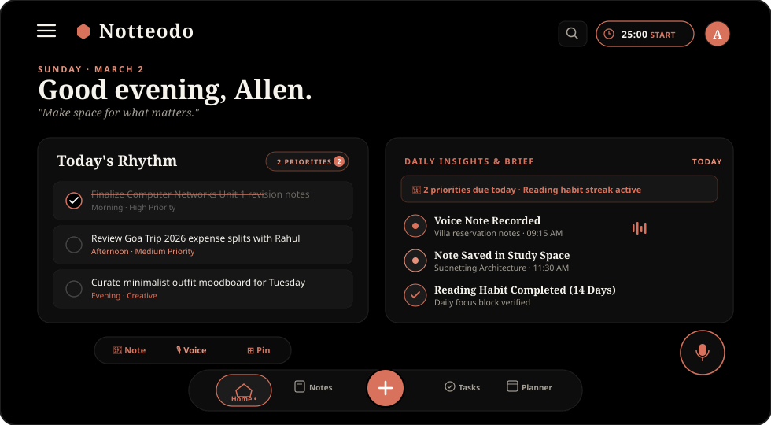
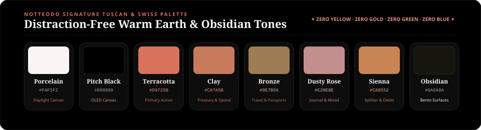

<div align="center">

<!-- LIVE HERO APP SHOWCASE -->
<a href="https://github.com/Allen73737/NOTtEodo">
  
</a>

<br/><br/>

# Notteodo

### *Notes · Tasks · Habits · Expenses · Wardrobe · Moodboards*
#### **The Aesthetic Personal Sanctuary & Life Dashboard**

<p align="center">
  <em>One beautiful, distraction-free space for your thoughts, daily routines, personal spending, and aesthetic inspiration.</em>
</p>

<!-- DYNAMIC BRAND SHIELDS (ZERO BLUE / ZERO TEAL) -->
<p align="center">
  <a href="https://flutter.dev"></a>
  <a href="https://dart.dev"></a>
  <a href="#-the-notteodo-palette"></a>
  <a href="#-the-notteodo-palette"></a>
  <a href="#-duolingo-style-animated-notifications"></a>
  <a href="#-aesthetic-pinterest-homescreen-widgets"></a>
  <a href="https://github.com/Allen73737/NOTtEodo/actions"></a>
  <a href="#-license"></a>
</p>

<!-- REAL-TIME HIGHLIGHTS TICKER -->
<p align="center">
  <code>✦ 100% LOCAL-FIRST</code> &nbsp;•&nbsp;
  <code>🎙️ NATIVE AUDIO STUDIO</code> &nbsp;•&nbsp;
  <code>⚡ OMNI-CAPTURE HUB</code> &nbsp;•&nbsp;
  <code>🔥 DUOLINGO NOTIFICATIONS</code> &nbsp;•&nbsp;
  <code>🦉 NODO AI COMPANION</code> &nbsp;•&nbsp;
  <code>📌 PINTEREST WIDGETS</code> &nbsp;•&nbsp;
  <code>🔒 ZERO SUBSCRIPTIONS</code>
</p>

<br/>

[Overview & Abstract](#-about-notteodo) •
[Why Notteodo?](#-why-notteodo) •
[Market-Leading Features](#-market-leading-productivity-suite) •
[Native Audio Studio Engine](#-native-android-audio-studio-engine) •
[Duolingo-Style Notifications](#-duolingo-style-animated-notifications) •
[Nodo AI Companion](#-nodo-ai-companion--personality) •
[Pinterest Homescreen Widgets](#-aesthetic-pinterest-homescreen-widgets) •
[Core Life Modules](#-core-life-modules) •
[Help, Privacy & Settings](#-help-privacy--settings-subpages) •
[Admin Dashboard & Controls](#-built-in-admin-dashboard) •
[The Color Palette](#-the-notteodo-palette) •
[Quickstart Runbook](#-quickstart-guide) •
[License](#-license)

<br/>


</div>

<br/>

## 📖 About Notteodo

> *"Make space for what matters."*

**Notteodo** is a free, beautifully crafted personal life dashboard built with Flutter. It unifies your notes, daily to-dos, habit streaks, personal finances, wardrobe curation, and Pinterest-style visual moodboards into one fast, private, distraction-free app.

Whether you're jotting down quick ideas, organizing your week, splitting dinner expenses with friends, planning your seasonal outfits, or checking your daily goals right from your phone's home screen, Notteodo makes everyday organization feel calm, tactile, and rewarding.

---

<br/>

## 💡 Why Notteodo?

Modern productivity apps have become cluttered, bloated, and full of monthly paywalls:

| The Old Way | The Notteodo Way |
| :--- | :--- |
| **5 to 10 disconnected apps** (one for notes, one for to-dos, another for budgeting, another for habits) | **One cohesive, beautiful dashboard** where all your daily routines live together seamlessly |
| **Pricy monthly subscriptions** leasing your own thoughts and lists back to you | **100% Free & Open Source** forever — no paywalls, no tiers, no locked features |
| **Cloud surveillance & trackers** scanning your personal entries for targeted ads | **Offline-first privacy** — your data lives safely on your device with military-grade AES-256 GCM encryption |
| **Sterile corporate grey grids** and overwhelming dopamine notifications | **Pinterest & Watchmaker aesthetic** with warm paper cream, pure OLED pitch black, Breguet focus dials, and warm terracotta accents |

---

<br/>

<div align="center">

</div>

<br/>

## 🚀 Market-Leading Productivity Suite

Notteodo combines world-class personal organization capabilities designed to outperform bloated mainstream tools while keeping your workflow private, tactile, and calm:

<div align="center">

| Feature | What It Does | Why It Elevates Your Workflow |
| :--- | :--- | :--- |
| **⚡ Omni-Capture Speed Hub** | Universal quick-capture modal (`OmniCaptureModal`) with on-device natural language parsing (`NlpDateParser`). | Type `"Dinner with Sarah $45 tomorrow at 7pm #dining"` and Notteodo automatically extracts the amount, due date, category, and tags, routing it to Notes, Tasks, Habits, or Expenses in seconds. |
| **🔥 14-Week Habit Heatmap** | 98-day continuous activity matrix (`HabitHeatmapWidget`) displaying real-time daily consistency. | Inspired by GitHub commit graphs, giving you an honest, motivating, high-level bird's-eye view of your habit discipline across months. |
| **🏺 Curator's Cabinet** | 8 collectible antique horological milestone badges (`CuratorsCabinetWidget`). | Earn tangible achievements (*Kindling Spark*, *Brass Lantern*, *Sacred Hearth*, *Supernova Corona*, *Golden Phoenix*, *Watchmaker Apprentice*, *Master Horologist*, *Vault Guardian*) with celebratory haptics. |
| **🕯️ Evening Zen Review** | Mindful daily shutdown ritual dialog (`EveningZenReviewDialog`). | Closes open mental loops by reviewing today's completed tasks, celebrating streaks, prompting a 1-sentence gratitude reflection, and sealing the day with an animated wax seal stamp (`WaxSealStamp`). |
| **🔍 Universal Spotlight Search** | Instant global search overlay (`UniversalSpotlightModal`) triggered via `⌘K` or search icon. | Real-time cross-module search indexing Notes, Tasks, Habits, Expenses, and Wardrobe with quick category pills and deep 1-tap navigation. |
| **📊 7-Day Expense Pacing Graph** | Visual spend velocity graph (`ExpensePacingGraphWidget`) benchmarked against daily budget limits. | Compares everyday spend against your budget baseline, paired with proactive, friendly companion commentary from Nodo and top category breakdowns. |
| **⏰ Daily Flow Time-Blocking** | 24-hour visual schedule timeline (`DailyFlowTimelineWidget`). | Maps your open tasks to mindful 2-hour rhythm intervals and provides a 1-tap `⚡ FOCUS` button to jump straight into the Watchmaker Focus Dial. |

</div>

---

<br/>

<div align="center">

</div>

<br/>

## 🎙️ Native Android Audio Studio Engine

Voice memos in Notteodo are built on a high-fidelity native Android audio engine engineered directly in `MainActivity.kt` and `voice_studio_modal.dart` without external UI popups or cloud dependencies:

- **Hardware AAC Recording:** High-fidelity audio encoding to `.m4a` files using Android's native `MediaRecorder` with adaptive bitrates.
- **Built-in Audio Playback:** Listen back to your voice notes directly inside the app with Android `MediaPlayer`, complete with play/pause toggles, seek scrubbing, and real-time waveform visualization.
- **Background Speech-to-Text:** On-device voice transcription via Android `SpeechRecognizer` running quietly in the background with **ZERO intrusive Google UI popups or dialogs**.
- **1-Tap Workflow Conversion:** Instantly convert voice memos into structured notes or action items with transcription copy and local audio playback controls.

---

<br/>

<div align="center">

</div>

<br/>

## 🔔 Duolingo-Style Animated Notifications

Notteodo reimagines productivity notifications with playful, visually addictive, Duolingo-style graphics that keep you engaged and protect your daily momentum:

<div align="center">

| Component | Visual & Interactive Character | Technical Implementation |
| :--- | :--- | :--- |
| **🔥 Native Dynamic Mascot** | 128×128 circular canvas badge with warm terracotta/gold radial gradient, executive gold rim, and emoji mascot (`🔥` for streak, `🦉` for Nodo) | Android native `createMascotLargeIcon()` in `NotificationReceiver.kt` |
| **⚡ 1-Tap Shade Actions** | Direct action buttons inside the Android shade: `"🔥 Check In"` to save daily streak or `"⚡ Focus 25m"` to launch Pomodoro timer | Intent extras dispatched directly into Flutter via MethodChannels |
| **🦉 In-App Floating HUD** | Tactile floating banner with animated breathing aura glow, bobbing mascot avatar (`🔥`, `🦉`, `⚡`, `🛡️`), and spring bounce entrance (`Curves.easeOutBack`) | Custom `SanctuaryAnimatedNotificationCard` with `TickerProviderStateMixin` |
| **⏳ Depleting Progress Line** | Smooth dual-gradient progress countdown bar running along the bottom border showing exact remaining notification lifetime | Reactive `AnimationController` binding (`widget.lifeController`) |
| **⏰ User-Configurable OS Cadence** | User-customizable notification intervals (1h, 2h, 3h default, 4h, 6h, 12h, or Once Daily) triggering smart reflection prompts, focus sprints, and streak shields | Android `AlarmManager.AlarmClockInfo` + dynamic `DailyEngagementService` scheduling |
| **🌍 Global Timezone Adaptation** | Seamless local wall-clock delivery (09:30 Morning Briefing & 21:30 Evening Zen Daily Recap) across any location (IST, EST, GMT, JST) | Auto-detects device timezone; `NotificationReceiver` listens for `ACTION_TIMEZONE_CHANGED` on travel |

</div>

---

<br/>

<div align="center">

</div>

<br/>

## 🦉 Nodo AI Companion & Personality

Notteodo features **Nodo**, an empathetic, on-device AI companion designed to feel like a thoughtful partner rather than a sterile chatbot:

- **Context-Aware Memory:** Automatically synchronizes with your profile display name, bio motto, active habit streaks, and pending tasks so every response feels personal.
- **Dual Companion Modes:**
  - 🌟 **"Inspire Me":** Philosophical, calming maxims designed to re-center your attention and ground your daily intentions.
  - 🔥 **"Roast My Focus":** Witty, affectionate, tough-love reality checks that push you to stop over-planning and conquer your top open priority right now.
- **Autonomous Note-to-Workflow:** Intelligently extracts actionable tasks and financial disbursements from unstructured notes.
- **Weekly Executive Dossier:** Synthesizes cross-module velocity into a clean executive summary every week.

---

<br/>

<div align="center">

</div>

<br/>

## 📌 Aesthetic Pinterest Homescreen Widgets

Bring the cozy, aesthetic vibe of Notteodo directly onto your phone's home screen. With our built-in **Interactive Widget Studio**, you can preview, customize, and pin 8 distinctive home screen widgets on Android and iOS:

<div align="center">

| Widget Type | What it Shows | Aesthetic Details |
| :--- | :--- | :--- |
| 📝 **Sticky Note & Memo** | Latest thought, pinned note excerpt, or quote | Textured paper card, serrated washi tape strip, editorial Bodoni title |
| ✅ **Daily Ritual Checklist** | Top tasks due today + habit streak progress | Checkbox progress counter (`4/5 DONE`), strikethrough typography |
| 🖼️ **Polaroid Inspiration Pin** | Highlighted image from your moodboards | Authentic Polaroid white photo border with handwritten italic caption |
| 👗 **Outfit of the Day** | Current season look, silhouettes, and fabric swatches | Clean editorial layout, temperature indicator, and palette dots |
| 💰 **Treasury & Budget Meter** | Monthly spend pacing and today's outflows | Minimal cash meter, currency symbol, and burn rate progress bar |
| 🎙️ **Voice Note Memo** | Quick voice note title, audio waveform, and duration | Retro cassette tape reels with red recording indicator |
| ✈️ **Travel Boarding Pass** | Next trip destination and departure countdown | Perforated airline ticket border with airport code route (`CDG ✈ HND`) |
| ⏱️ **Focus Clock & Quote** | Live system time + rotating daily reflection prompt | Classic horological dial with clean typography |

</div>

> [!TIP]
> Open the in-app **Widget Studio** anytime from **Settings $\rightarrow$ Homescreen Widget Studio** to preview paper styles, choose washi tape colors, and instantly test how each widget looks on your home screen.

---

<br/>

<div align="center">

</div>

<br/>

## 🌌 Core Life Modules

Notteodo is organized into cohesive spaces so you can navigate your day effortlessly:

```
┌─────────────────────────────────────────────────────────────────────────────────┐
│                                NOTTEODO DASHBOARD                               │
├─────────────────────┬─────────────────────┬─────────────────────┬───────────────┤
│  01. HOME BENTO     │  02. SMART NOTES    │  03. TASKS & HABITS │  04. EXPENSES │
│  Daily Overview     │  Rich Markdown & AI │  Priority Checklist │  Personal &   │
│  & Morning Briefing │  Media Attachments  │  Streak Habit Rings │  Group Splits │
├─────────────────────┼─────────────────────┼─────────────────────┼───────────────┤
│  05. WARDROBE       │  06. MOODBOARDS     │  07. TRAVEL SPACES  │  08. ADMIN    │
│  Outfit Planner &   │  Pinterest Masonry  │  Packing Lists &    │  System       │
│  Garment Inventory  │  Visual Aesthetics  │  Itinerary Passports│  Control Room │
└─────────────────────┴─────────────────────┴─────────────────────┴───────────────┘
```

1. **Home Bento & Morning Briefing:** A serene morning overview displaying your top priorities, active habit streaks, planned outfit, and budget pacing without any stressful clutter.
2. **Watchmaker Focus Dial:** Swiss horology-inspired Pomodoro dial with animated Breguet hands sweeping over an ivory chapter ring with custom ambient soundscapes (rain on parchment, fireplace, coffee shop).
3. **Notes & Documents:** Clean markdown writing with rich formatting, document tags, photo attachments, and a grounded AI assistant that answers questions directly from your own notes.
4. **Tasks & Habits:** Keep track of urgent to-dos and daily habits. Build positive streaks through 5 evolutionary flame tiers (Kindling Spark $\rightarrow$ Golden Phoenix).
5. **Expenses & Bill Splitting:** Log everyday expenses, track monthly budgets, and easily calculate fair group splits with friends without needing a separate split app.
6. **Wardrobe & Outfits:** Catalog your clothes, build seasonal outfit pairings, and plan what to wear based on weather and events.
7. **Moodboards & Aesthetics:** Infinite visual pinboards for interior design, fashion inspiration, typography, architecture, and creative projects.
8. **Travel & Trips:** Trip planners with flight itinerary cards, packing matrices, and shared travel spending ledgers.

---

<br/>

<div align="center">

</div>

<br/>

## ⚙️ Help, Privacy & Settings Subpages

Every category in the Settings screen expands into an interactive, dedicated subpage:

- **❓ Help & Support (`HelpSupportSubpage`):**
  - **18 Comprehensive FAQs** covering streaks, vault PINs, timer soundscapes, budget burn rates, calendar exports, and sync.
  - **Real-Time Search & Category Filters:** Live text filtering and category pills (*Streaks & Habits*, *Privacy & Security*, *AI Companion*, *Focus & Timer*, *Backup & Sync*, *Budget & Expenses*).
  - **Interactive Accordion:** Copy answer to clipboard and submit helpful feedback with one tap.
- **🛡️ Privacy & Data Safety (`PrivacySafetySubpage`):**
  - **100% Local-First Transparency:** Transparent audit showing local SQLite encryption, opt-in cloud sync, and 0 third-party tracking SDKs.
  - **Complete Data Ownership Controls:** Instant 1-tap "Export Full Archive (JSON)", "Clear Temporary Cache", and "Permanently Erase All Data" with verification safeguards.
- **🔔 Notifications & Cadence (`NotificationsSettingsSubpage`):**
  - **User-Configurable On-Device Cadence:** Choose from `1h`, `2h`, `3h (Balanced Default)`, `4h`, `6h`, `Twice Daily (12h)`, or `Once Daily (24h)` intervals with live daily check-in counter estimate.
  - **Intelligent Quiet Hours & Briefing Sync:** Automatically respect sleep windows (e.g. 22:00 to 07:00) and space daytime triggers harmoniously between Morning Briefing and Evening Reflection times.
  - **Master Kill-Switch & Audit Log:** Instant 1-tap toggle to silence or resume all system notifications, alarms, and streak alerts, plus full dispatched notification history and audit log.
- **ℹ️ About NOTtEodo (`AboutNotteodoSubpage`):**
  - Craftsmanship philosophy, technical specifications grid (Flutter 3.x, SQLite, AES-256 GCM, Tuscan Warmth), and `v2.5.0 Production Edition` badge.
- **💬 Feedback & Feature Suggestions:**
  - Direct form in the navigation drawer allowing users to send feature suggestions and bug reports directly to the Admin Command Center with real-time status tracking (*Pending*, *Reviewed*, *In Progress*, *Resolved*).

---

<br/>

<div align="center">

</div>

<br/>

## 👑 Built-in Admin Dashboard

Notteodo includes a dedicated **Administrative Command Center** built right into the universal login page. It gives administrators full visibility and control over app infrastructure, storage quotas, and security policies.

### Secure Administrator Access

Administrative access is configured securely via environment variables in your private `.env` file (refer to `.env.example`):

- **Private Configuration:** Set `ADMIN_EMAIL` and `ADMIN_PASSWORD` in your local `.env`.
- **Universal Sign-In Gateway:** Sign in with your designated administrator account on the standard login screen to automatically unlock the Administrative Command Center.
- **Zero Exposed Secrets:** Administrative credentials and master keys are kept private in your environment and are never published in public documentation.

### Administrative Controls Overview

- **Interactive Operating Guide & Quick Navigator:** Integrated expandable walkthrough banner at the top of the command center with direct 1-tap jump pills to all 7 hubs (`01 Overview`, `02 Users & Roles`, `03 Cloud & Sync`, `04 Local Vault`, `05 AI Models`, `06 Alerts & Logs`, `07 Feedback`), contextual guidance tips, and clear safety consequence badges (`[SAFE DIAGNOSTIC]`, `[PERSISTENT CONFIG]`, `[SENSITIVE]`).
- **Real Infrastructure Benchmarks & Zero Hardcoded Artifacts:** Eliminated mock pings, dummy data, and hardcoded keys. Replaced with dynamic environment resolution (`AppConfig.cloudinaryCloudName`, `AppConfig.resolvedSupabaseUrl`), live round-trip HTTP latency checks, real media asset catalog scanning, and real database compaction via encrypted local storage flush.
- **Pixel-Perfect UI Alignment & Mobile Responsiveness:** Precision-aligned two-column specification rows, auto-scaling fitted metric cards with safe height constraints, and native `AppBar` integration ensuring zero clipping or header overflow across all screen sizes (small phones, tablets, and desktop monitors).
- **Overview & Live Telemetry:** Real-time health check across all database tables, encrypted local storage key count, active records count, system uptime, and cryptographic verification.
- **User Feedback & Suggestions Console:** Review and triage incoming user feature requests and feedback directly with roadmap status tags and admin notes.
- **Cloudinary Media Vault Governance:** Monitor media storage, scan active images across notes, wardrobe, and moodboard pins, and evict stale image disk caches with 1 tap.
- **Ledger & Database Compaction:** Re-verify SHA-256 tamper-evident audit chains, trigger encrypted database compaction, and export full-database JSON backup snapshots.
- **AI & Neural Engine Governance:** Switch active LLMs (Groq LLaMA 3.3 70B Versatile, Mixtral 8x7B), toggle the Direct & Concise Tone Filter, tune companion persona archetypes, and flush daily briefing cache.
- **System Maintenance & Live Logs:** Publish global broadcast advisory banners, test instant and scheduled lockscreen push notifications, benchmark haptic feedback waveforms, and view the circular ring buffer terminal with level filters (`AUDIT`, `ERROR`, `WARN`, `INFO`), PII redaction, and one-click JSONL export.

---

<br/>

<div align="center">

</div>

<br/>

## 🎨 The Notteodo Palette

Notteodo's visual design is strictly free of corporate blues, harsh cyans, and artificial neon gradients. It transitions seamlessly between **Terracotta-Infused Porcelain White** for daylight clarity and **Pure Pitch Black OLED** for nighttime focus.

<div align="center">
  
</div>

<br/>

<div align="center">

| Color Token | Hex Code | Visual Character & App Role |
| :--- | :---: | :--- |
| `AppColors.darkBackground` | `#000000` | **Pitch Black OLED:** True 100% black pixels for battery saving and night comfort |
| `AppColors.darkSurfaceHigh` | `#0A0A0A` | **Obsidian Charcoal:** High-contrast solid dark surfaces for bento cards |
| `AppColors.darkBorder` | `#1E1E1E` | **Titanium Hairline:** Subtle, clean card borders in dark mode |
| `AppColors.onSurface` | `#1D1C15` | **Warm Charcoal Ink:** Editorial typography for daylight reading |
| `AppColors.background` | `#FAF5F2` | **Terracotta Porcelain White:** Warm white infused with subtle terracotta glow |
| `AppColors.secondary` | `#D9725B` | **Terracotta Red:** Primary buttons, active tabs, and completed checkmarks |
| `AppColors.goldPrimary` | `#D4AF37` | **Imperial Gold:** Focus timer accents, crown admin badges, and gold seals |
| `AppColors.themePlanner` | `#D9725B` | **Warm Terracotta:** Habit streaks, calm productivity lanes, and calendar milestones |
| `AppColors.themeExpenses` | `#C87A5B` | **Terracotta Clay:** Expense categories, budget meters, and treasury balances |
| `AppColors.themeSplitter` | `#C88552` | **Warm Amber:** Group debt settlement cards and shared expenses |
| `AppColors.themeJournal` | `#C28E8E` | **Dusty Rose:** Personal journal entries and mood reflections |
| `AppColors.themeTravel` | `#9E7B56` | **Antique Saddle Bronze:** Travel passports, departure cards, and packing lists |

</div>

---

<br/>

## 📱 Real-Device Experience & Ergonomic Enhancements

To ensure world-class physical phone usability and delight, Notteodo incorporates dedicated ergonomic refinements:

- 🔙 **Full In-App History Back Navigation & Gestures:** Tapping the device back button or performing the edge-swipe gesture navigates back through previously visited sections via an intelligent navigation history stack (`PopScope`), with a dedicated back arrow icon button in the mobile header across all sub-views.
- 🚪 **Exit Reconfirmation Dialog:** When back is triggered on the Home screen with an empty history stack, Notteodo presents a luxury reconfirmation dialog (*"Exit NOTtEodo?"* with *Stay* and *Exit App* options) to guard against accidental exits and confirm all sanctuary data is safely stored.
- 📝 **Immediate "+ New Note" Header Button:** Positioned directly in the Notes title header row on all screen sizes, ensuring 1-tap note creation without having to scroll.
- 🛡️ **Zero-Flicker Permission Flow:** Fixed the Android notification permission requesting loop, ensuring the Privacy Shield lock only engages on true background/suspend states without glitching during system permission dialogues.
- 🔕 **Master Notifications Kill-Switch:** Added a direct 1-tap master switch at the top of Notifications Settings to silence or reactivate all alerts, reminders, and alarms simultaneously.
- 🧘 **Refined Zen Mode Typography:** Left-aligned unconstrained Bodoni typography displaying the user's full name without awkward truncation, paired with a clean top-row "EXIT ZEN" action.
- 📦 **Collapsible Daily Briefing & Flow Time-Blocking:** Both the AI Daily Briefing and the 24-hour Daily Flow Timeline feature smooth collapse/expand toggles and are **collapsed by default** to keep Home clean, serene, and uncluttered.
- ⏱️ **Focus Dial in App Drawer:** Accessible directly with a dedicated timer badge from the workspace section of the navigation drawer.
- ⚙️ **Direct Profile-to-Settings Navigation:** Integrated a quick Settings button immediately in the Profile header row.
- 📊 **Strict Calendar-Week Heatmap Grid:** 14-week activity grid strictly aligned to Monday–Sunday columns with weekday labels ("M", "T", "W", "T", "F", "S", "S"), terracotta/gold gradients, and today highlight.
- 🎙️ **Native Voice Recording to Journal:** Real-time speech recognition streaming directly from Android's native engine, with recorded audio file paths persisted to Journal memoirs and played back via the luxury cassette tape interface.
- 💬 **Dynamic, Real-World Daily Briefings:** AI briefings powered by actual pending tasks, habits, and spending with natural, encouraging everyday English.
- 🎴 **Luxury Bento Journal Cards:** Replaced decorative faux leather stitch artifacts with clean, modern bento cards displaying mood tags and voice note indicators.
- ✨ **Animated Feature Walkthrough:** Seamless animated step transitions with Flutter's yellow text underline artifacts permanently resolved.
- 📖 **Clear Everyday Vocabulary:** Streamlined terminology across all onboarding slides, prompts, and settings for immediate universal accessibility.
- 🌓 **Automatic System Default Theme:** Dynamically inherits system dark/light theme preference (`ThemeMode.system`) with manual overrides available.
- 🎨 **Glitch-Free Theme Switching & Scrolling:** Eliminated theme desync and flickering during scrolling by setting instantaneous atomic theme propagation (`themeAnimationDuration: Duration.zero`), accelerating the ink wash bloom to 460ms, preventing touch scroll desync during bloom transitions, and aligning wash canvas tokens strictly with porcelain terracotta white (`#FAF5F2`) and pitch black OLED (`#000000`).
- 🎯 **Header Bar Cleanup:** Removed redundant search buttons near capture on Home and placed a Settings gear icon immediately to the left of the theme toggle in the top header.
- 📅 **Native Google Calendar Event Insertion & Prefilled Sync:** Fixed Google Calendar integration on Android by replacing empty app launches with multi-tier native Calendar insertion (`Intent.ACTION_INSERT` targeting `com.google.android.calendar`, device calendar provider `CalendarContract.Events.CONTENT_URI`, and modern `/calendar/u/0/r/eventedit` web fallback) with title, start/end timestamps, descriptions, and locations fully prefilled.
- 🕒 **Horological Analog Clock Dial Time Selector for Reminders & Due Dates:** Introduced an interactive analog clock dial picker (`TimePickerEntryMode.dial`) and `HorologicalMiniClockDial` / `HorologicalClockBadge` featuring real-time hour/minute hands styled in terracotta (`#D9725B`), warm gold (`#D4AF37`), and obsidian. Users can now pick exact reminder and due times directly on an analog clock face across the Task Editor, Event Planner, Habit tracker, and task list cards with automatic day rollover and countdown alerts.
- 🏛️ **Dual Card & List Architecture (Bento vs. Swiss Minimalist Editorial):** Introduced an instant user-configurable toggle in Settings → *Display & Layout* allowing curators to switch between *Architectural Bento Pods* (rounded 20px chamfers, subtle depth, and soft physical drop shadows) and *Swiss Minimalist Editorial* (borderless flush paper, razor-thin 0.8px hairline dividers, and generous whitespace). All animations (120Hz press scaling, fluid checkmarks, wax seals, audio reels, and clock hands) remain 100% active and uncompromised across both styles.

---

<br/>

<div align="center">

</div>

<br/>

## 🛠️ Quickstart Guide

### Prerequisites
- **Flutter SDK:** `3.24` or newer ([Install Flutter](https://docs.flutter.dev/get-started/install))
- **Dart SDK:** `3.5` or newer
- **Browser, Android Device / Emulator, or iOS Simulator**

### 1. Clone & Setup
```bash
# Clone the repository
git clone https://github.com/Allen73737/NOTtEodo.git
cd NOTtEodo

# Configure your local environment variables
cp .env.example .env
```

### 2. Run the App
```bash
# Move to the Flutter frontend directory
cd frontend

# Install dependencies
flutter pub get

# Run on Chrome / Web
flutter run -d chrome

# Or run on Android / iOS
flutter run -d android
flutter run -d ios
```

### 3. Verification & Testing
```bash
# Run static code analysis (0 errors, 0 warnings, 0 infos)
flutter analyze lib

# Run the complete test suite (140 passing tests across all modules)
flutter test
```

---

<br/>

<div align="center">

</div>

<br/>

## ⚖️ License

Distributed under the **MIT License**. See [LICENSE](LICENSE) for full details.

<br/>

<div align="center">

```
  ✦ · ✦ · ✦
  "Make space for what matters."
  Notteodo · Notes · Tasks · Habits · Expenses · Life
```


</div>
