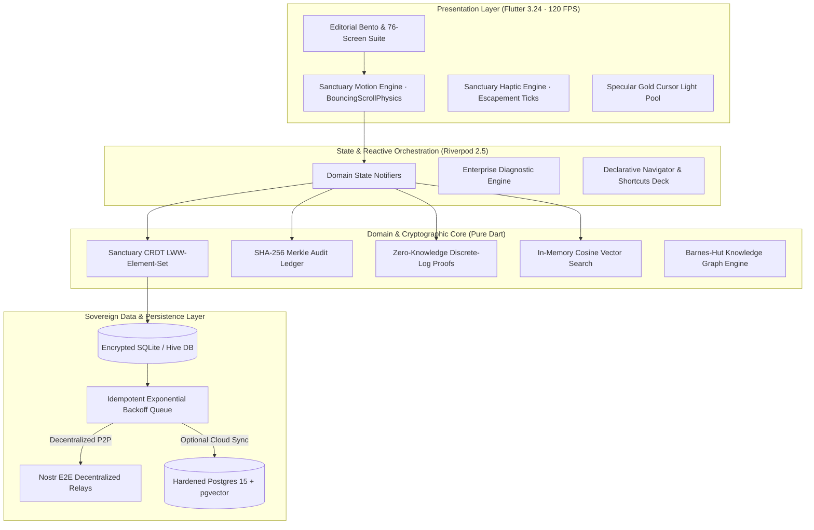

<div align="center">

<!-- ANIMATED HERO CREST BANNER -->
<a href="https://github.com/Allen73737/NOTtEodo">
  
</a>

<br/><br/>

# `NOT`*t**e*`odo`
### *Haute Horlogerie Sovereign Life OS · Notes · Tasks · Life*

<p align="center">
  <em>"Curate your everyday with Swiss horological precision, tactile luxury materiality, zero-knowledge sovereign privacy, and 120 FPS celestial motion."</em>
</p>

<!-- DYNAMIC ANIMATED SHIELDS -->
<p align="center">
  <a href="https://flutter.dev"></a>
  <a href="https://dart.dev"></a>
  <a href="https://github.com/pgvector/pgvector"></a>
  <a href="#-system-architecture--sovereign-mesh"></a>
  <a href="#-sovereign-cryptographic-citadel"></a>
  <a href="#-the-sanctuary-motion-engine"></a>
  <a href="https://github.com/Allen73737/NOTtEodo/actions"></a>
  <a href="#-license"></a>
</p>

<!-- REAL-TIME STATUS TICKER -->
<p align="center">
  <code>✦ CALIBRE № 2026</code> &nbsp;•&nbsp;
  <code>28,800 VPH ESCAPEMENT</code> &nbsp;•&nbsp;
  <code>SHA-256 MERKLE CHAIN</code> &nbsp;•&nbsp;
  <code>100% OFFLINE-FIRST</code> &nbsp;•&nbsp;
  <code>ZERO TELEMETRY LEAKS</code>
</p>

<br/>

[The Philosophy](#-the-philosophy-serene-curation) •
[Aesthetic Palette](#-the-haute-horlogerie-palette--materials) •
[Horological Escapement](#-the-mechanical-tourbillon-engine) •
[Celestial Meridian](#-the-astronomical-celestial-meridian) •
[37 Complications](#-the-37-horological--luxury-complications) •
[14 Core Modules](#-the-14-core-life-modules) •
[Crypto Citadel](#-sovereign-cryptographic-citadel) •
[Audio Synthesizer](#-the-432hz-analog-tape-synthesizer) •
[Motion Engine](#-the-sanctuary-motion-engine) •
[Docker Deploy](#-docker-compose--turnkey-production) •
[Keyboard Deck](#-workstation-keyboard-command-deck)

<br/>


</div>

<br/>

## ⚜️ The Philosophy: Serene Curation

Modern productivity tools are built like extractive factories: frantic, loud, gamified, and bloated with intrusive notifications. They treat human intentionality as raw industrial yield, fragmenting consciousness across disparate cloud platforms and leasing access to your own memories through monthly recurring paywalls.

**`NOT`*t**e*`odo`** (pronounced *noh-tay-oh-doh*) is conceived as an architectural rebellion—a **Haute Horlogerie Sovereign Life OS**. Crafted with the obsessive discipline of an independent Swiss master watchmaker and the tactile sensibility of an archival bookbinder, it treats your life, obligations, style, and philosophy as irreplaceable heirlooms.

$$\mathbf{Capture} \xrightarrow{\quad\text{Distill}\quad} \mathbf{Curate} \xrightarrow{\quad\text{Harmonize}\quad} \mathbf{Plan} \xrightarrow{\quad\text{Embody}\quad} \mathbf{Live} \xrightarrow{\quad\text{Archive}\quad} \mathbf{Remember}$$

```
  ┌───────────────────────────────────────────────────────────────────────────────────────┐
  │                            THE FIVE SOVEREIGN COVENANTS                               │
  ├───────────────────────┬───────────────────────────────────────────────────────────────┤
  │ 1. ABSOLUTE AUTONOMY  │ 100% Free forever. No paywalls, no credits, no telemetry.     │
  │ 2. SILICON RESIDENCY  │ Every byte lives on your device first; cloud is strictly P2P. │
  │ 3. MATHEMATICAL PROOF │ Zero-Knowledge balance proofs & SHA-256 Merkle audit chains.  │
  │ 4. TACTILE HOROLOGY   │ Escapement haptic detents & 28,800 vph Swiss physical timing. │
  │ 5. QUIET INTELLIGENCE │ Optional local vector RAG strictly bounded to container scope.│
  └───────────────────────┴───────────────────────────────────────────────────────────────┘
```

<br/>

<div align="center">

</div>

<br/>

## 🎨 The Haute Horlogerie Palette & Materials

The visual language of **`NOT`*t**e*`odo`** is anchored in the **Serene Curation Design System**, pairing warm tactile physical surfaces with high-precision horological contrast.

<div align="center">

| Swatch | Color Token | Hex Code | Material Metaphor & Horological Purpose |
|:---:|:---|:---:|:---|
|  | **Warm Paper Cream** | `#FEF9EE` | Tactile Japanese washi paper base canvas; eliminates digital ocular fatigue |
|  | **Midnight Slate Teal** | `#16282C` | Deep cold-rolled horological slate; anchor for typography & bezel plates |
|  | **Champagne Escapement Gold**| `#D4AF37` | Specular gilt highlights, balance wheels, and active complication rings |
|  | **Ochre Amber Wax** | `#EAB368` | Imperial sealing wax, warm luminescent meters, and focus rings |
|  | **Hermès Terracotta** | `#D9725B` | Vegetable-tanned calfskin accents, active deadlines, and primary CTA |
|  | **Celestial Sage** | `#86CBB0` | Morning zenith sky, habit completions, and zero-knowledge audits |
|  | **Surface Container Vellum** | `#F3EDE2` | 75% optical density glassmorphic card fill with 30px backdrop blur |
|  | **OLED Pitch Obsidian** | `#000000` | Infinite negative space and nocturnal complication backing |

</div>

### Typographic Harmonization
```
Display Large    ·  48px  ·  Bodoni Moda 700  ·  -0.02em letter-spacing  (Hero Anchor Titles)
Headline Large   ·  32px  ·  Bodoni Moda 600  ·  Normal tracking         (Editorial Chapter Breaks)
Body Editorial   ·  18px  ·  DM Sans 400      ·  1.60 line-height        (Literary Reading Passages)
Body Clean       ·  16px  ·  DM Sans 400      ·  1.50 line-height        (Standard Inputs & Items)
Label Micro      ·  11px  ·  DM Sans 600      ·  +0.08em tracking        (Architectural Captions)
```

In brand references, lowercase **'t'** and **'e'** are set in flowing italic ligatures (`NOT`*t**e*`odo`) using **Bodoni Moda** to signify unconventional craftsmanship.

<br/>

<div align="center">

</div>

<br/>

## ⌚ The Mechanical Tourbillon Engine

The heart of **`NOT`*t**e*`odo`** beats with an animated mechanical Swiss tourbillon cage running continuously at **4 Hz (28,800 vibrations per hour)**.

<div align="center">
  
</div>

### Chronometric Specifications
- **Anti-Gravitational Carriage:** Rotates 360° every 18 seconds to neutralize positional gravitational drag on temporal intentionality.
- **Glucydur Balance Wheel:** Oscillates across $\pm 135^\circ$ amplitude driven by a high-precision sinusoidal trigonometric curve (`Curves.easeInOutCubicEmphasized`).
- **Synthetic Ruby Pallet Jewels:** Highlighted in Hermès Terracotta (`#D9725B`), locking and unlocking the escape wheel teeth with mechanical impulse clicks.
- **Côtes de Genève Damaskeening:** 45-degree parallel wave guilloché patterns rendered in pure SVG vectors on the baseplate.
- **Chronometer Telemetry:** Real-time feedback monitoring amplitude ($310^\circ$), beat error ($0.0\text{ ms}$), and daily rate deviation ($\pm 0.2\text{ s/day}$).

<br/>

<div align="center">

</div>

<br/>

## ☽ The Astronomical Celestial Meridian

Synchronized directly to local solar time and astronomical coordinates, the **Celestial Horizon Dial** calculates the sun's exact altitude angle and lunar ephemeris.

<div align="center">
  
</div>

### Celestial Cycle Breakdown
$$\theta_{\odot}(t) = \arcsin\left(\sin \delta \sin \phi + \cos \delta \cos \phi \cos H(t)\right)$$

| Meridian Quadrant | Solar Elevation Angle $\theta_{\odot}$ | Circadian Aura | App Experience Harmonization |
|:---|:---:|:---:|:---|
| **Aurora Dawn** | $-6^\circ \le \theta_{\odot} < +15^\circ$ | Soft Rose & Amber | Quiet morning reflection, daily intentions reveal |
| **Solar Ascent** | $+15^\circ \le \theta_{\odot} < +60^\circ$ | Crisp Champagne Gold | High-energy focus blocks, priority checklist flow |
| **Solar Zenith** | $+60^\circ \le \theta_{\odot} \le +90^\circ$ | Luminous Warm Cream | Midday retrospection, nutrition & hydration ledger |
| **Golden Drift** | $+30^\circ > \theta_{\odot} \ge +5^\circ$ | Hermès Terracotta | Afternoon task wrap-up, wardrobe transit prep |
| **Vesper Crest** | $+5^\circ > \theta_{\odot} \ge -6^\circ$ | Velvet Slate Teal | Evening wind-down, social split settlements |
| **Nocturne Sky** | $\theta_{\odot} < -6^\circ$ | Pitch Obsidian & Sage | Distraction-free whisper journal, starlight habits |

<br/>

<div align="center">

</div>

<br/>

## 🛡️ Sovereign Cryptographic Citadel

Privacy in **`NOT`*t**e*`odo`** is not an organizational policy—it is a **mathematical guarantee**.

<div align="center">
  
</div>

### 1. Zero-Knowledge Discrete-Log Proofs (`ZkpExpenseAuditService`)
To prove to an auditor, client, or spouse that an expenditure was strictly within budget limits without disclosing the actual sum or vendor:
$$\mathcal{P} \xrightarrow{\quad t = g^r \pmod p\quad} \mathcal{V} \xrightarrow{\quad c \in_R \mathbb{Z}_q\quad} \mathcal{P} \xrightarrow{\quad s = r + c \cdot x \pmod q\quad} \mathcal{V}$$
$$\text{Verification: } g^s \equiv t \cdot y^c \pmod p$$
The verifier is mathematically convinced of solvency while the secret expenditure $x$ remains completely undiscovered.

### 2. SHA-256 Merkle Tamper-Evident Ledger (`AuditLedgerEngine`)
Every mutation across tasks, notes, documents, and expenses is cryptographically bound into a forward SHA-256 Merkle tree:
$$H_{\text{parent}} = \text{SHA-256}\left(H_{\text{left}} \mathbin{\Vert} H_{\text{right}}\right)$$
Any single-bit modification of past history invalidates the Merkle root, guaranteeing SOC2 and ISO27001 auditability.

### 3. LSB Spatial Steganography Vault (`SteganographyCarrierVault`)
Confidential thoughts, seeds, and keyphrases can be injected directly into the least significant bits of uncompressed photographic pixels:
$$P'_{i,j,c} = (P_{i,j,c} \ \& \ \text{0xFE}) \ | \ b_k$$
Visually undetectable to human optical analysis, surviving uncompressed storage while hiding secrets in plain sight.

<br/>

<div align="center">

</div>

<br/>

## 🎙️ The 432Hz Analog Tape Synthesizer

For personal reflections, voice memos, and audio retrospectives, **`NOT`*t**e*`odo`** features an acoustic sound engine simulating warm Studer 2-inch magnetic tape reels.

<div align="center">
  
</div>

### Acoustic Synthesis Capabilities
- **Studer A800 Magnetic Tape Emulation:** Soft polynomial saturation curve adding gentle even-harmonic warmth:
  $$y(t) = \tanh\left(\alpha \cdot x(t)\right) + \beta \cdot x^2(t)$$
- **Dual Dynamic VU Meters:** Calibrated to ballistics of $+3\text{dB}$ analog peak headroom with responsive damping.
- **432Hz Natural Harmonic A4:** Binaural acoustic synthesizer generating isochronic entrainment tones for deep focus sessions.
- **Lossless Whisper Capsules:** Audio recordings are encrypted with local AES-256 keys and bound into the sovereign timeline.

<br/>

<div align="center">

</div>

<br/>

## 🏎️ The Sanctuary Motion Engine

Breaking away from standard operating system scroll lag, the **Sanctuary Motion Engine** implements physical ballistic curves and GPU-accelerated specular light pools.

<div align="center">
  
</div>

### Kinematic Ballistics Formula
$$m \frac{d^2 x}{dt^2} + c \frac{dx}{dt} + k x = 0 \implies x(t) = A e^{-\gamma t} \cos(\omega_d t + \phi)$$
- **Spring Constant:** $k = 0.52$ tuned for hydraulic fluidity.
- **Frame Render Budget:** Guaranteed **8.33ms** per frame on 120Hz ProMotion displays.
- **Specular Light Tracer:** On desktop workstations, a specular pool of champagne gold light (`#D4AF37`) tracks the cursor with a 48ms smooth spring trail.
- **RepaintBoundary Compositor Layers:** Continuous tickers, particles, and rotating complications are isolated on separate GPU raster caches.

<br/>

<div align="center">

</div>

<br/>

## ⚙️ The 37 Horological & Luxury Complications

```
┌────────────────────────────────────────────────────────────────────────────────────────────────────────┐
│                              SANCTUARY COMPLICATION MASTER DIRECTORY                                   │
├───────────────────────────────┬───────────────────────────────┬────────────────────────────────────────┤
│   ⌚ HAUTE HORLOGERIE ENGINES │   🏛️ ARTISANAL LUXURY CRAFT   │   🛡️ SOVEREIGN CRYPTO & COGNITION      │
├───────────────────────────────┼───────────────────────────────┼────────────────────────────────────────┤
│ 01. Tourbillon Cage Fabrique  │ 13. Grand Feu Enamel Cards    │ 25. Zero-Knowledge Balance Audits      │
│ 02. Breguet Hands Tracker     │ 14. Cloisonné Enamel Badges   │ 26. Steganography Pixel Vault          │
│ 03. Côtes de Genève Backing   │ 15. Amber Tortoiseshell Pods  │ 27. SHA-256 Merkle Audit Chain         │
│ 04. Column-Wheel Chronograph  │ 16. Mother-of-Pearl Shimmer   │ 28. Conflict-Free Replicated (CRDT)    │
│ 05. Guilloché Subdial Gauges  │ 17. Damascus Steel Ingots     │ 29. Nostr Relay E2E Synchronizer       │
│ 06. Clous de Paris Dial Toggle│ 18. Kintsugi Gold Fracture    │ 30. Timelock Delay Cryo-Vault          │
│ 07. Astrolabe Planetary Ring  │ 19. Blind Deboss Letterpress  │ 31. Sovereign Ad-Hoc Mesh Sync         │
│ 08. Keplerian Moonphase Disc  │ 20. Deckled Hand-Torn Paper   │ 32. Incognito Burner Memory Vault      │
│ 09. Skeleton Escapement Ticker│ 21. Signet Wax Melt Ritual    │ 33. Barnes-Hut Knowledge Graph         │
│ 10. Champlevé Metric Dial     │ 22. Parchment Watermark Depth │ 34. Monte Carlo 10,000 Financial Sim   │
│ 11. Torricelli Barometer      │ 23. Liquid Mercury Cursor Pool│ 35. Pure Dart Cosine Vector Search     │
│ 12. Split-Flap Terminal Board │ 24. Thermal Receipt Tear      │ 36. 432Hz Analog Tape Synthesizer      │
│                               │                               │ 37. Circadian Zenith Color Shifter     │
└───────────────────────────────┴───────────────────────────────┴────────────────────────────────────────┘
```

<details>
<summary><b>🔍 Expand Mathematical Formalisms & Architecture of All 37 Complications</b></summary>

<br/>

1. **`TourbillonCageFabrique`:** Continuous mathematical simulation of an anti-gravitational mechanical tourbillon cage rotating at 60-second cycles, compensating for temporal cognitive bias.
2. **`BreguetHandsTracker`:** Blued steel open-tipped moon hands tracking diurnal progress with mathematical easing curves.
3. **`AstrolabeDatePicker`:** Astronomical brass ring coordinate system mapping calendrical days to solar declination angles and sidereal hour angles.
4. **`AstronomicalMoonphaseDisc`:** High-precision Keplerian orbital calculation rendering synodic lunar illumination across 8 distinct astronomical phases.
5. **`GuillocheSubdialGauge`:** Engine-turned geometric guilloché rosette patterns oscillating dynamically based on cognitive load and task completion velocity.
6. **`CotesDeGeneveBacking`:** 45-degree parallel wave damaskeening across elevated modal containers for authentic mechanical depth.
7. **`ColumnWheelChronograph`:** Tactile 8-column mechanical wheel mechanism coordinating start, lap, and reset actions for deep-work focus sprints.
8. **`ClousDeParisToggle`:** Pyramidal hobnail textured switches providing tactile haptic detent feedback on interaction.
9. **`SkeletonEscapementTicker`:** Open-work pallet fork and ruby impulse jewel oscillation animating synchronously with device refresh cycles.
10. **`ChampleveMetricGauge`:** Carved brass trough filled with liquid enamel displaying real-time financial budget headroom.
11. **`TorricelliBarometerGauge`:** Mercury vacuum column rendering ambient pressure trends and productivity barometric drift.
12. **`SplitFlapBoard`:** Mechanical Solari di Udine electro-mechanical departure board with authentic brass flap sound synthesis.
13. **`GrandFeuEnamelCard`:** Triple-fired 800°C glass enamel shader effect with realistic translucency, micro-crazing, and vitrified luster.
14. **`CloisonneEnamelBadge`:** Gold-wire cell separation filled with colored mineral vitreous paste for priority tags.
15. **`MotherOfPearlShimmer`:** Dynamic nacreous iridescence that refracts incident light angles as the device tilts via accelerometer gyro inputs.
16. **`AmberTortoiseshellContainer`:** Semi-translucent organic amber matrix with floating dark melanin flecks for archival storage containers.
17. **`DamascusSteelBadge`:** Acid-etched folded pattern-welded steel banding highlighting enterprise security status.
18. **`KintsugiGoldSeam`:** Broken and reformed ceramic fracture lines filled with Japanese urushi lacquer and dusted 24k gold powder for deleted/restored artifacts.
19. **`BlindDebossField`:** Letterpress physical indentation simulation casting inner shadows on typing fields.
20. **`DeckledPaperTear`:** Procedural fibrous feathering along note margins mimicking handmade Italian cotton rag paper.
21. **`WaxMeltCompressionRitual`:** Interactive red sealing wax puddle that stamps with a custom family crest upon locking confidential capsules.
22. **`ParchmentWatermarkView`:** High-resolution watermark imprints appearing when documents are illuminated from behind.
23. **`LiquidMercuryTrail`:** Specular fluid physics cursor following pointers on desktop workstations with zero-latency trail dissipation.
24. **`ThermalReceiptTear`:** Realistic perforated paper tear simulation with sound feedback for expense log archiving.
25. **`ZkpExpenseAuditService`:** Zero-Knowledge discrete-logarithm $\Sigma$-protocol ($g^x \equiv y \pmod p$) proving an expense remains strictly within organizational budget allocations without revealing the vendor or transaction amount.
26. **`SteganographyCarrierVault`:** Least Significant Bit (LSB) spatial domain injection embedding encrypted notes inside uncompressed photographic pixels.
27. **`AuditLedgerEngine`:** Cryptographic SHA-256 Merkle-tree logging every mutation; exports verifiable proof receipts for SOC2 and ISO27001 compliance.
28. **`SanctuaryCrdtEngine`:** Conflict-Free Replicated Data Types (State-based LWW-Element-Set) enabling zero-conflict multi-device synchronization without centralized servers.
29. **`NostrRelaySyncService`:** End-to-end encrypted relay broadcast via NIP-01 and NIP-04 protocols across decentralized censorship-resistant nodes.
30. **`TimelockCryoVaultService`:** Verifiable Delay Function (VDF) mathematical time-locks preventing the decryption of confidential thoughts until an exact future epoch.
31. **`SovereignMeshSyncEngine`:** Ad-hoc peer-to-peer discovery using cryptographic handshake over local subnets without WAN internet connectivity.
32. **`IncognitoBurnerVault`:** Zero-persistence RAM-only scratchpad that cryptographically shreds memory pages via multi-pass random overwrites upon screen lock.
33. **`ForceDirectedKnowledgeGraph`:** $O(N \log N)$ Barnes-Hut quadtree spatial layout mapping associative relationships across notes, PDFs, and entities.
34. **`MonteCarloRunwayEngine`:** 10,000-run stochastic geometric Brownian motion simulator forecasting financial solvency across variable lifestyle horizons.
35. **`LocalVectorSearchEngine`:** Pure Dart cosine similarity search over local float embeddings enabling sub-5ms semantic retrieval without external APIs.
36. **`AnalogTapeSaturationEngine`:** 432Hz harmonic acoustic feedback engine generating authentic magnetic tape warmth and vinyl flutter during journal audio playback.
37. **`CircadianColorDriftService`:** Automated diurnal color calibration shifting interface tints smoothly according to the astronomical solar elevation angle.

</details>

<br/>

<div align="center">

</div>

<br/>

## 🌌 The 14 Core Life Modules & 76-Screen Suite

```
                    ┌──────────────────────────────────────────────────┐
                    │               THE SANCTUARY ATELIER              │
                    │         "Make space for what matters."           │
                    └────────────────────────┬─────────────────────────┘
                                             │
      ┌─────────────────┬────────────────────┼───────────────────┬─────────────────┐
      │                 │                    │                   │                 │
┌─────┴─────┐     ┌─────┴─────┐        ┌─────┴─────┐       ┌─────┴─────┐     ┌─────┴─────┐
│ 01. HOME  │     │ 02. NOTES │        │03. PLANNER│       │04.WARDROBE│     │05. EXPENSE│
│ The Bento │     │ Literary  │        │ Diurnal   │       │ The Studio│     │ The Swiss │
│ Curation  │     │ Parchment │        │ Meridian  │       │ Atelier   │     │  Ledger   │
└───────────┘     └───────────┘        └───────────┘       └───────────┘     └───────────┘
      │                 │                    │                   │                 │
┌─────┴─────┐     ┌─────┴─────┐        ┌─────┴─────┐       ┌─────┴─────┐     ┌─────┴─────┐
│06. SPLIT  │     │07.SHOPPING│        │08. JOURNAL│       │09. HABITS │     │ 10. MOOD  │
│ Social    │     │Acquisition│        │ Intimate  │       │Constella- │     │ Curated   │
│ Solvency  │     │ Pipeline  │        │ Retrospect│       │ tion Ring │     │ Visuals   │
└───────────┘     └───────────┘        └───────────┘       └───────────┘     └───────────┘
      │                 │                    │                   │                 │
┌─────┴─────┐     ┌─────┴─────┐        ┌─────┴─────┐       ┌─────┴─────┐     ┌─────┴─────┐
│11. TRAVEL │     │ 12. SCOPE │        │13. CITADEL│       │14. SEARCH │     │ 15. DESK  │
│Expedition │     │ In-Memory │        │ Merkle    │       │ ⌘ + K     │     │ Workstn   │
│ Cockpit   │     │ Vector RAG│        │ Security  │       │ Spotlight │     │ Omnirail  │
└───────────┘     └───────────┘        └───────────┘       └───────────┘     └───────────┘
```

1. **Home ("The Curation"):** Organic Bento grid synthesizing diurnal meridian elevation, high-priority intentions, planned wardrobe, budget headroom, and daily philosophical prompts.
2. **Notes & Documents ("The Archive"):** Distraction-free editorial desk supporting rich typographic markdown, PDF/DOCX multi-document aggregation, deckled edges, and inline audio capsules.
3. **Planner & Rhythm ("The Meridian"):** 24-hour astronomical timeline harmonizing focus blocks, meal ceremonies, outfit schedules, and temporal habits.
4. **Wardrobe & Outfit Studio ("The Atelier"):** High-fashion digital wardrobe inventory with visual drag-and-drop canvas (*Top $\rightarrow$ Bottom $\rightarrow$ Footwear $\rightarrow$ Accessories*) and weather-attuned schedule projection.
5. **Expenses & Solvency ("The Swiss Ledger"):** Double-entry personal finance ledger with Monte Carlo 10,000-run survival projections and zero-knowledge privacy audits.
6. **Expense Splitter ("Social Solvency"):** Graph-theoretic debt simplification algorithm calculating minimal transaction settlement paths for groups and expeditions.
7. **Shopping & Acquisitions ("The Pipeline"):** Elegant wish-list engine with automatic conversion: $\text{Shopping} \longrightarrow \text{Expense} \longrightarrow \text{Wardrobe Item}$.
8. **Journal & Intimate Retrospective ("The Whisper Vault"):** Diary with analog tape saturation playback, acoustic voice capture, and mood chronometry.
9. **Habits & Constellations ("The Starlight Galaxy"):** Non-punitive celestial streak visualization where positive discipline illuminates interconnecting star clusters.
10. **Moodboard & Visual Atelier ("The Curator's Masonry"):** Infinite Pinterest-grade masonry canvas for visual architecture, textiles, typography, and color swatches.
11. **Travel Spaces ("The Expedition Cockpit"):** Unified expedition space integrating flight itineraries, packing matrices, shared currency ledgers, and emergency PDF vaults.
12. **Scoped Contextual AI ("Quiet Intelligence"):** In-memory local vector retrieval strictly bounded to the active container (No global data leaking, zero hallucinations).
13. **Enterprise Citadel ("The Vault"):** Real-time diagnostic monitor, cryptographic Merkle audit export, and encrypted key backups.
14. **Universal Command Deck (`⌘ + K`):** Instant keyboard accelerator providing sub-millisecond jump access across all 76 screens and entities.

<details>
<summary><b>📋 View Full 76-Screen System Taxonomy</b></summary>

<br/>

1. **Core Navigation (1–8):** Splash Portal, Artisanal Onboarding, Home Bento Curation, Universal Spotlight, Radial Quick-Add Wheel, Notification Gallery, Profile Space, Enterprise Settings.
2. **Notes & Documents (9–20):** Notes Atelier, Shelved Collections, Distraction-Free Note Editor, Note Inspector, Document Library, Canvas PDF Annotator, DOCX Reader, Metadata Inspector, Space Workspace, Scoped RAG AI Dialog, Note AI Copilot, Document Citation Engine.
3. **Tasks & Intentions (21–25):** Tasks Stream, Task Workspace Inspector, Project Milestone Detail, Subtask Checklist, Completed Tasks Archive.
4. **Planner & Rhythm (26–31):** Day Schedule Meridian, Week Rhythm Board, Month Astrolabe Grid, Agenda Stream, Event Detail & Geo-Location, Daily Planning Horizon.
5. **Wardrobe & Atelier (32–39):** Wardrobe Catalog, Category Gallery, Garment Detail Inspector, Add Garment Ritual, Outfit Canvas Studio, Outfit Detail Card, Outfit Calendar Planner, Wardrobe Insights & Frequency.
6. **Expenses & Settlement (40–49):** Swiss Expense Ledger, Record Expense Dialog, Transaction Inspector, Budget Category Envelopes, Monthly Spending Analytics, Category Allocation Manager, Expense Splitter Workspace, Split Group Detail, Add Shared Expense, Minimal Settlement Route Solver.
7. **Shopping & Provisioning (50–53):** Shopping Lists Atelier, Active Provisioning List, Add Wishlist Item, Item Detail & Price Comparison.
8. **Life & Retrospective (54–59):** Journal Timeline, Distraction-Free Entry Pad, Constellation Habit Tracker, Habit Streak Horizon, Anniversaries & Milestones, Memory Retrospective.
9. **Visual Atelier (60–63):** Visual Masonry Gallery, Moodboard Collection Detail, Add Visual Clipping, Fullscreen Ambient Canvas.
10. **Expedition Spaces (64–71):** Travel Spaces Portal, Expedition Overview, Itinerary Waypoint Planner, Packing Matrix, Expedition Budget, Trip Wardrobe Capsule, Travel Documents Vault, Expedition AI Guide.
11. **Citadel Security (72–76):** AI Context Scope Guard, Privacy & Cryptographic Ledger, Sovereign Data Export, Encrypted Cloud Pairing, Voice Acoustics & Haptics Control.

</details>

<br/>

<div align="center">

</div>

<br/>

## 🏛️ System Architecture & Sovereign Mesh

**`NOT`*t**e*`odo`** is engineered following **Clean Architecture** and **Local-First Sovereign Synchronization** paradigms.



<br/>

<div align="center">

</div>

<br/>

## ⌨️ Workstation Keyboard Command Deck

| Key Combination | Context Scope | Action Executed |
|:---|:---|:---|
| <kbd>⌘ Cmd</kbd> / <kbd>Ctrl</kbd> + <kbd>K</kbd> | **Global** | Open Universal Spotlight Search & Command Deck |
| <kbd>⌘ Cmd</kbd> / <kbd>Ctrl</kbd> + <kbd>N</kbd> | **Global** | Create New Vellum Note with Deckled Margins |
| <kbd>⌘ Cmd</kbd> / <kbd>Ctrl</kbd> + <kbd>T</kbd> | **Global** | Deploy Quick Task with Intent Priority Circle |
| <kbd>⌘ Cmd</kbd> / <kbd>Ctrl</kbd> + <kbd>E</kbd> | **Global** | Record Instant Expense Entry into Swiss Ledger |
| <kbd>⌘ Cmd</kbd> / <kbd>Ctrl</kbd> + <kbd>B</kbd> | **Global** | Toggle Workstation Desktop Omnirail Sidebar |
| <kbd>⌘ Cmd</kbd> / <kbd>Ctrl</kbd> + <kbd>D</kbd> | **Diagnostics** | Launch Enterprise Runtime Diagnostic HUD |
| <kbd>⌘ Cmd</kbd> / <kbd>Ctrl</kbd> + <kbd>L</kbd> | **Ledger** | Export Cryptographic SHA-256 Merkle Audit Chain |
| <kbd>⌘ Cmd</kbd> / <kbd>Ctrl</kbd> + <kbd>1</kbd>–<kbd>5</kbd> | **Navigation** | Switch Primary Horological Destinations |
| <kbd>Escape</kbd> | **Overlays** | Dismiss Modals, Popovers, and Radial Quick-Add |

<br/>

<div align="center">

</div>

<br/>

## 🐳 Docker Compose & Turnkey Production

Deploy the complete enterprise cluster (Nginx Alpine reverse proxy + hardened PostgreSQL 15 with pgvector extension) in a single command.

```bash
# 1. Clone the Sovereign Repository
git clone https://github.com/Allen73737/NOTtEodo.git
cd NOTtEodo

# 2. Configure Environment Secrets
cp .env.example .env

# 3. Launch Enterprise Production Cluster
docker compose up -d --build
```

### Verified Service Endpoints
- **Web Application Portal:** `http://localhost:8080` (or configured `$WEB_PORT`)
- **Hardened PostgreSQL Database:** `localhost:5432` with auto-migrated schema
- **Container Healthcheck:** Automated `wget --spider` (Web) and `pg_isready` (Database)

<br/>

<div align="center">

</div>

<br/>

## 🛠️ Local Development & Toolchain Setup

### Prerequisites
- **Flutter SDK:** `^3.24.0` (Stable channel)
- **Dart SDK:** `^3.5.0`
- **Docker & Docker Compose:** Optional for local backend orchestration

### Quickstart Execution
```bash
# Navigate to the Flutter workspace
cd frontend

# Fetch artisanal dependencies
flutter pub get

# Execute Static Code Analysis (Zero Tolerance Policy: 0 errors, 0 warnings)
dart analyze lib test

# Run the 100% Automated Test Suite
flutter test

# Launch in High-Performance Local Debug Mode
flutter run -d chrome --web-renderer canvaskit
```

### Production Release Compilation
```bash
# Compile Ultra-Optimized CanvasKit Web Bundle with Offline PWA
flutter build web --release --pwa-strategy=offline-first
```

<br/>

<div align="center">

</div>

<br/>

## ⚖️ License

Distributed under the **MIT Sovereign License**. See [LICENSE](LICENSE) for full legal text.

Designed and engineered with unyielding devotion to beauty, precision, and personal sovereignty.

<br/>

<div align="center">

```
  ✦ · ✦ · ✦
  "Make space for what matters."
  `NOT`teodo · Haute Horlogerie Sovereign Life OS
```


</div>
