<div align="center">

<!-- LIVE HERO APP SHOWCASE -->
<a href="https://github.com/Allen73737/NOTtEodo">
  
</a>

<br/><br/>

# NOTtEodo

### *Notes · Tasks · Habits · Expenses · Wardrobe · Moodboards · Audio Studio · Focus*
#### **The Aesthetic Personal Sanctuary & Life Suite**

<p align="center">
  <em>One distraction-free, local-first sanctuary for your thoughts, daily momentum, personal spending, aesthetic inspiration, and mindful focus.</em>
</p>

<!-- DYNAMIC BRAND SHIELDS (STRICT ZERO BLUE · ZERO GOLD · ZERO GREEN) -->
<p align="center">
  <a href="https://flutter.dev"></a>
  <a href="https://dart.dev"></a>
  <a href="#-the-notteodo-palette"></a>
  <a href="#-the-notteodo-palette"></a>
  <a href="#-on-device-notifications--signature-ribbon-monogram"></a>
  <a href="#-aesthetic-pinterest-homescreen-widgets"></a>
  <a href="https://github.com/Allen73737/NOTtEodo/actions"></a>
  <a href="#-license"></a>
</p>

<!-- REAL-TIME HIGHLIGHTS TICKER -->
<p align="center">
  <code>✦ 100% LOCAL-FIRST</code> &nbsp;•&nbsp;
  <code>🔄 DUAL BENTO &amp; SWISS EDITORIAL</code> &nbsp;•&nbsp;
  <code>🎙️ NATIVE AUDIO STUDIO</code> &nbsp;•&nbsp;
  <code>⚡ OMNI-CAPTURE HUB</code> &nbsp;•&nbsp;
  <code>📳 3D FLIP MICRO-HAPTICS</code> &nbsp;•&nbsp;
  <code>🦉 NODO ARCHITECT AI</code> &nbsp;•&nbsp;
  <code>⏰ EXACT ALARMS</code> &nbsp;•&nbsp;
  <code>🔒 ZERO SUBSCRIPTIONS</code>
</p>

<br/>

[Overview & Abstract](#-about-notteodo) •
[Why NOTtEodo?](#-why-notteodo) •
[Dual Visual Architecture](#-dual-visual-architecture-bento--swiss-editorial) •
[Notifications & Ribbon Monogram](#-on-device-notifications--signature-ribbon-monogram) •
[Admin AI Copilot (Nodo Architect)](#-sovereign-admin-ai-copilot-nodo-architect) •
[Watchmaker Focus Dial](#-watchmaker-focus-dial--customizable-timer) •
[Native Audio Studio Engine](#-native-android-audio-studio-engine) •
[Streaks & Celestial Astrolabe](#-habit-streaks-flame-evolution--celestial-astrolabe) •
[Travel Spaces & Passports](#-travel-spaces--itinerary-passports) •
[Local-First Cryptographic Security](#-local-first-security--cryptographic-ledger) •
[120Hz Spring Dynamics](#-120hz-spring-dynamics--mid-flip-micro-haptics) •
[Homescreen Widgets](#-aesthetic-pinterest-homescreen-widgets) •
[Android System Integrations](#-android-system-level-integrations) •
[The Color Palette](#-the-notteodo-palette) •
[Quickstart Runbook](#-quickstart-guide) •
[License](#-license)

<br/>


</div>

<br/>

## 📖 About NOTtEodo

> *"Make space for what matters."*

**NOTtEodo** is a free, beautifully engineered personal life sanctuary built with Flutter and Dart. It unifies your notes, priority checklists, habit streaks, personal finances, wardrobe curation, and Pinterest-style visual moodboards into one fast, private, distraction-free app.

Whether you're jotting down lightning-fast thoughts with natural-language dates, organizing your week, splitting group dinner expenses with friends, planning your seasonal outfit capsules with instant photo previews, recording high-fidelity voice memos, or checking your daily goals right from your Android home screen, NOTtEodo makes everyday organization feel calm, tactile, and rewarding.

<br/>

<div align="center">
  
</div>

<br/>

---

<br/>

## 💡 Why NOTtEodo?

Modern productivity apps have become cluttered, bloated, and full of monthly paywalls:

| The Old Way | The NOTtEodo Sanctuary Way |
| :--- | :--- |
| **5 to 10 disconnected apps** (one for notes, one for to-dos, another for budgeting, another for habits) | **One cohesive, beautiful dashboard** where all your daily routines live together seamlessly |
| **Pricy monthly subscriptions** leasing your own thoughts and lists back to you | **100% Free & Open Source** forever — no paywalls, no tiers, no locked features |
| **Cloud surveillance & trackers** scanning your personal entries for targeted ads | **Offline-first privacy** — your data lives safely on your device with military-grade AES-256 GCM encryption |
| **Sterile corporate grey grids** and overwhelming dopamine notifications | **Tuscan warmth & Swiss print aesthetic** with warm porcelain cream, pure OLED pitch black, Breguet focus dials, and warm terracotta accents |
| **Monolithic, locked-in UI design** forcing one view onto every user | **Dual Visual Architecture** — switch effortlessly between tactile 120Hz Bento Cards and Swiss Editorial print typography |

---

<br/>

<div align="center">

</div>

<br/>

## 🔄 Dual Visual Architecture: Bento & Swiss Editorial

NOTtEodo is built from the ground up on a dual-paradigm presentation engine. A single tap on the **`Aa`** switcher button anywhere in the app instantly transforms the viewport between two distinct aesthetic worlds:

<div align="center">
  
</div>

<br/>

<div align="center">

| Aesthetic Characteristic | 🍱 Bento Architecture (Cards Mode) | 📰 Swiss Editorial (Print Mode) |
| :--- | :--- | :--- |
| **Visual Metaphor** | Physical obsidian deck of cards with depth and chamfers | Fine stationery, Kinfolk magazine, and Swiss editorial print |
| **Layout Philosophy** | High-contrast bento pods with tactile rounded containers | Flush typography on paper; no boxes, borders, or redundant pills |
| **Motion Physics** | **120Hz Spring Dynamics:** 0.975 tactile depression, 4.0px hover lift | **Calm Page Turns:** Gentle opacity dissolves and 3D card flips |
| **Moodboard Visuals** | 3D Polaroid flip cards with handwritten notes on the back | Interactive 3D flippable photo cards (`setEntry(3, 2, 0.001)`) |
| **Wardrobe Previews** | High-resolution garment grid with season & fabric swatches | Clean list rows with 52×52 rounded chamfer thumbnails on the outside |
| **Typography Hierarchy** | Large, legible `13.5–15sp` body text with DM Sans & Space Grotesk | High-fashion Bodoni Moda, literary Playfair Display, and DM Sans |
| **In-App Toast Alerts** | Animated floating bento card with pulsing mascot aura glow | Quiet, book-weight Swiss print card with hairline terracotta line |
| **Where to Switch** | Top App Bar, Hamburger Drawer, Settings, Admin Dashboard, and Sign-In Screen (`Aa` pill) | Top App Bar, Hamburger Drawer, Settings, Admin Dashboard, and Sign-In Screen (`Aa` pill) |

</div>

<br/>

<div align="center">
  
</div>

<br/>

---

<br/>

<div align="center">

</div>

<br/>

## 🔔 On-Device Notifications & Signature Ribbon Monogram

NOTtEodo features a custom-engineered, battery-optimized Android notification architecture powered by Android exact alarms and a mathematically traced brand vector monogram:

<div align="center">
  
</div>

<br/>

<div align="center">

| Component | Visual & Interactive Character | Technical Implementation |
| :--- | :--- | :--- |
| **✨ Signature Ribbon 'N' Monogram** | Crisp, resolution-independent dual-loop calligraphy vector mark rendered across status bar, lockscreen, and notification headers | Android VectorDrawable in `ic_stat_notteodo.xml` derived from `NotteodoMonogramGeometry` |
| **🔥 Dynamic Mascot Large Icon** | 160×160 Tuscan obsidian squircle with terracotta accent border and contextual emoji badge (`🔥` streak, `⚡` focus, `🌅` morning, `🦉` Nodo) | Android native `createAppLogoLargeIcon()` in `NotificationReceiver.kt` with memory-safe downsampling |
| **⚡ 1-Tap Shade Actions** | Direct action buttons inside the Android shade: `"✨ Check In"` to save daily streak, `"⚡ Focus 25m"` to launch timer, or `"✍️ Quick Note"` | Intent extras dispatched directly into Flutter via MethodChannels |
| **⏳ Depleting Progress Line** | Smooth dual-gradient countdown bar along the bottom edge showing exact remaining notification lifetime | Reactive `AnimationController` binding (`widget.lifeController`) |
| **⏰ 3-Hour Exact Alarm Cadence** | Intelligent daytime cadence (every 3h between 09:30 and 21:30) with automatic legacy migration | `USE_EXACT_ALARM` + `setExactAndAllowWhileIdle` in Kotlin `ReminderScheduler.kt` |
| **🛡️ System Doze Immunity** | Bypasses aggressive battery optimization and deep sleep while respecting custom quiet hours | Verified across Android 12, 13, 14, and Nothing OS |

</div>

---

<br/>

<div align="center">

</div>

<br/>

## 🦉 Sovereign Admin AI Copilot: Nodo Architect

Built directly into the Admin Dashboard, **NODO ARCHITECT** is an on-device, sovereign administrative intelligence copilot designed to assist system curators with telemetry, diagnostics, and data operations:

<div align="center">
  
</div>

<br/>

- **Live System Health Audits:** Real-time analysis of SQLite cipher state, notification queue depth, test pass status, and memory integrity with zero dummy data.
- **One-Tap Diagnostic Triggers:**
  - `⚡ Run Full Health Audit`: Validates database integrity and reports instant status.
  - `🔔 Fire Test Notification`: Instantly sends an on-device broadcast notification to verify sound, icon, and actions.
  - `📊 Audit Record Counts`: Inspects live row counts across Notes, Tasks, Habits, Expenses, and Wardrobe.
  - `🛡️ Error Log Forensics`: Scans internal logs for uncaught exceptions, R8 warnings, or memory pressure.
- **Server-Side Lockdown:** Secured via `public.app_admins` table and PostgreSQL Row-Level Security (RLS) policies.

---

<br/>

<div align="center">

</div>

<br/>

## ⏱️ Watchmaker Focus Dial & Customizable Timer

Inspired by high Swiss horology (Abraham-Louis Breguet), NOTtEodo's focus timer turns productivity into an intentional, meditative ritual:

<div align="center">
  
</div>

<br/>

- **Animated Breguet Hands:** Real-time ticking Breguet balance hands sweeping smoothly over an ivory chapter ring with Tuscan obsidian and terracotta styling (strictly zero yellow/gold).
- **Customizable Timer Durations:**
  - One-tap quick presets: **15 min**, **25 min** *(Classic Pomodoro)*, **45 min**, **60 min**, and **90 min** *(Ultradian Rhythm)*.
  - Smooth custom duration slider spanning **5 min to 180 min**.
- **Ambient Soundscapes:** Built-in generative focus audio including *Deep Sanctuary Rain*, *Tibetan Singing Bowl*, *Forest Rain*, and *Silent Sanctuary*.
- **Ongoing Notification Controls:** Real-time lockscreen notification with remaining time countdown and Pause/Resume/Stop playback actions.

---

<br/>

<div align="center">

</div>

<br/>

## 🎙️ Native Android Audio Studio Engine

Voice memos in NOTtEodo are powered by a native Android audio engine engineered directly in `MainActivity.kt` and `voice_studio_modal.dart` without external UI popups or cloud dependencies:

<div align="center">
  
</div>

<br/>

- **Hardware AAC Recording:** High-fidelity audio encoding to `.m4a` files using Android's native `MediaRecorder` with adaptive bitrates.
- **Built-in Audio Playback:** Listen back to voice notes directly inside the app with Android `MediaPlayer`, complete with play/pause toggles, seek scrubbing, and real-time waveform visualization.
- **Background Speech-to-Text:** On-device voice transcription via Android `SpeechRecognizer` running quietly in the background with **ZERO intrusive Google UI popups or dialogs**.
- **1-Tap Workflow Conversion:** Instantly convert voice memos into structured notes, daily tasks, or logged expenses with transcription copy and local audio playback controls.

---

<br/>

<div align="center">

</div>

<br/>

## 🌌 Habit Streaks, Flame Evolution & Celestial Astrolabe

Build compounding daily momentum through continuous activity tracking and collectible milestone achievements:

<div align="center">
  
</div>

<br/>

- **🔥 14-Week Habit Heatmap:** 98-day continuous activity matrix (`HabitHeatmapWidget`) displaying real-time daily consistency, inspired by GitHub commit graphs.
- **🕯️ Streak Flame Evolution:** 5 progressive flame tiers celebrating long-term discipline:
  - *Tier 1: Spark of Inception* (1–6 Days)
  - *Tier 2: Steady Hearth Flame* (7–20 Days)
  - *Tier 3: Roaring Forge Flame* (21–49 Days)
  - *Tier 4: Astral Plasma Flame* (50–99 Days)
  - *Tier 5: Immortal Supernova Flame* (100+ Days)
- **🏺 Curator's Cabinet:** 8 collectible antique horological milestone trophies (*Kindling Spark*, *Brass Lantern*, *Sacred Hearth*, *Supernova Corona*, *Golden Phoenix*, *Watchmaker Apprentice*, *Master Horologist*, *Vault Guardian*).
- **🌙 Evening Zen Review:** Mindful daily shutdown ritual dialog (`EveningZenReviewDialog`) discoverable 24/7 across Home, Momentum, and Profile, sealing the day with an animated wax seal stamp (`WaxSealStamp`).

---

<br/>

<div align="center">

</div>

<br/>

## ✈️ Travel Spaces & Itinerary Passports

Plan journeys, coordinate packing essentials, and split adventure expenses with clean, travel-ready cards:

<div align="center">
  
</div>

<br/>

- **Perforated Airmail Ticket Stubs:** Authentic travel cards displaying departure countdowns, destination airport codes (`CDG ✈ HND`), and flight numbers.
- **Interactive Packing Matrices:** Categorized checklist lanes for *Essentials*, *Clothing*, *Electronics*, and *Toiletries* with completion tracking.
- **Shared Journey Spending:** Log travel disbursements and compute instant group debt settlements without switching to an external splitter.

---

<br/>

<div align="center">

</div>

<br/>

## 🔒 Local-First Security & Cryptographic Ledger

Your personal sanctuary belongs exclusively to you. NOTtEodo operates with an offline-first architecture designed to withstand zero network connectivity:

<div align="center">
  
</div>

<br/>

- **Military-Grade AES-256 GCM:** Database files and secure tokens encrypted at rest via hardware-backed Android Keystore and iOS Keychain.
- **Zero Third-Party SDKs:** No Google Analytics, no Facebook SDK, no advertising identifiers, and no telemetry tracking your thoughts.
- **Biometric App Lock:** Optional fingerprint and Face Unlock biometric authentication via `local_auth`.
- **Complete Data Ownership:** Instant 1-tap "Export Full Archive (JSON)", "Clear Temporary Cache", and "Permanently Erase All Data" with verification safeguards.

---

<br/>

<div align="center">

</div>

<br/>

## 📳 120Hz Spring Dynamics & Mid-Flip Micro-Haptics

Every interaction inside NOTtEodo is calibrated to feel physical, responsive, and grounded:

<div align="center">
  
</div>

<br/>

- **Tactile Depression Dynamics:** Cards respond instantly to touch with a calibrated `0.975` scale depression and `4.0px` hover lift.
- **Mid-Flip Micro-Haptics:** Real-time perspective animation listener tracking the exact $90^\circ$ midpoint ($t = 0.5$) of card rotations, delivering an authentic physical "card snap" tactile click in your palm.
- **Hardware Haptic Synthesis:** Subtle `HapticFeedback.selectionClick()` on slider ticks and `lightImpact()` when completing daily priorities.

---

<br/>

<div align="center">

</div>

<br/>

## 📌 Aesthetic Pinterest Homescreen Widgets

Bring the calm, aesthetic vibe of NOTtEodo directly onto your phone's home screen. With our built-in **Interactive Widget Studio**, you can preview, customize, and pin 8 distinctive home screen widgets on Android and iOS in both **Bento** and **Swiss Editorial** styles:

<div align="center">

| Widget Type | What it Shows | Aesthetic Details |
| :--- | :--- | :--- |
| 📝 **Sticky Note & Memo** | Latest thought, pinned note excerpt, or quote | Textured paper card, serrated washi tape strip, editorial Bodoni title |
| ✅ **Daily Ritual Checklist** | Top tasks due today + habit streak progress | Checkbox progress counter (`4/5 DONE`), strikethrough typography |
| 🖼️ **Polaroid Inspiration Pin** | Highlighted image from your moodboards | Authentic Polaroid white photo border with handwritten italic caption |
| 👗 **Outfit of the Day** | Current season look, silhouettes, and fabric swatches | Clean editorial layout, temperature indicator, and palette dots |
| 💰 **Treasury & Budget Meter** | Monthly spend pacing and today's outflows | Minimal cash meter, currency symbol, and burn rate progress bar |
| 🎙️ **Voice Note Memo** | Quick voice note title, audio waveform, and duration | Retro cassette tape reels with red recording indicator |
| ✈️ **Travel Boarding Pass** | Next trip destination and departure countdown | Perforated airline ticket border with airport code route (`CDG ✈ HND`) |
| ⏱️ **Focus Clock & Quote** | Live system time + rotating daily reflection prompt | Classic horological dial with clean typography |

</div>

> [!TIP]
> Open the in-app **Widget Studio** anytime from **Settings $\rightarrow$ Homescreen Widget Studio** to preview paper styles, choose washi tape colors, and toggle between Bento and Swiss Editorial widget styling.

---

<br/>

<div align="center">

</div>

<br/>

## 📱 Android System-Level Integrations

NOTtEodo is engineered as a first-class citizen on modern Android devices, leveraging system capabilities for effortless access:

<div align="center">

| System Feature | Technical Implementation | Practical Daily Benefit |
| :--- | :--- | :--- |
| **⚡ Launcher Quick Shortcuts** | Declared in `shortcuts.xml` and wired via deep links (`notteodo://shortcut/*`) | Long-press the NOTtEodo icon on your Android home screen to immediately trigger **Quick Capture**, **Voice Memo**, or **Focus Timer** without waiting. |
| **🎨 Themed Material You Icon** | Monochromatic vector squircle defined in `mipmap-anydpi-v26/ic_launcher.xml` | Automatically adapts to your Android 13+ wallpaper dynamic color palette when system "Themed Icons" are enabled. |
| **📳 Precision Micro-Haptics** | Native haptic pulses (`HapticFeedback.selectionClick()` & `lightImpact()`) | Delivers tactile feedback when completing tasks, tuning dials, and flipping 3D Polaroid moodboards. |
| **📅 Native Calendar Integration** | Multi-tier Android `CalendarContract` intent insertion | Adds events and reminders directly into Google Calendar with start/end timestamps and descriptions prefilled. |

</div>

---

<br/>

<div align="center">

</div>

<br/>

## 🎨 The NOTtEodo Palette

NOTtEodo's visual design is strictly free of corporate blues, harsh cyans, bright greens, and loud yellows or golds. It transitions seamlessly between **Terracotta-Infused Porcelain White** (`#FAF5F2`) for daylight clarity and **Pure Pitch Black OLED** (`#000000`) with obsidian surfaces for nighttime focus.

<div align="center">
  
</div>

<br/>

<div align="center">

| Color Token | Hex Code | Visual Character & App Role |
| :--- | :---: | :--- |
| `AppColors.darkBackground` | `#000000` | **Pitch Black OLED:** True 100% black pixels for battery saving and night comfort |
| `AppColors.darkSurfaceHigh` | `#0A0A0A` | **Obsidian Charcoal:** High-contrast solid dark surfaces for bento cards |
| `AppColors.darkBorder` | `#1E1E1E` | **Titanium Hairline:** Subtle, clean card borders in dark mode |
| `AppColors.onSurface` | `#1D1C15` | **Warm Charcoal Ink:** Editorial typography for daylight reading |
| `AppColors.background` | `#FAF5F2` | **Terracotta Porcelain White:** Warm white infused with subtle terracotta glow |
| `AppColors.secondary` | `#D9725B` | **Terracotta Red:** Primary buttons, active tabs, and completed checkmarks |
| `AppColors.goldPrimary` | `#D9725B` | **Warm Terracotta:** Executive accents, focus dials, and admin badges (zero yellow/gold) |
| `AppColors.themePlanner` | `#D9725B` | **Warm Terracotta:** Habit streaks, calm productivity lanes, and calendar milestones |
| `AppColors.themeExpenses` | `#C87A5B` | **Terracotta Clay:** Expense categories, budget meters, and treasury balances |
| `AppColors.themeSplitter` | `#C88552` | **Warm Sienna:** Group debt settlement cards and shared expenses |
| `AppColors.themeJournal` | `#C28E8E` | **Dusty Rose:** Personal journal entries and mood reflections |
| `AppColors.themeTravel` | `#9E7B56` | **Antique Saddle Bronze:** Travel passports, departure cards, and packing lists |

</div>

---

<br/>

<div align="center">

</div>

<br/>

## 🛠️ Quickstart Guide

### Prerequisites
- **Flutter SDK:** `3.24` or newer ([Install Flutter](https://docs.flutter.dev/get-started/install))
- **Dart SDK:** `3.5` or newer
- **Browser, Android Device / Emulator, or iOS Simulator**

### 1. Clone & Setup
```bash
# Clone the repository
git clone https://github.com/Allen73737/NOTtEodo.git
cd NOTtEodo

# Configure your local environment variables
cp .env.example .env
```

### 2. Run the App
```bash
# Move to the Flutter frontend directory
cd frontend

# Install dependencies
flutter pub get

# Run on Chrome / Web
flutter run -d chrome

# Or run on Android / iOS
flutter run -d android
flutter run -d ios
```

### 3. Verification & Testing
```bash
# Run strict static code analysis (0 errors, 0 warnings, 0 infos)
dart analyze lib test --fatal-infos

# Run the complete test suite (245 passing tests across all modules)
flutter test
```

---

<br/>

<div align="center">

</div>

<br/>

## ⚖️ License

Distributed under the **MIT License**. See [LICENSE](LICENSE) for full details.

<br/>

<div align="center">

```
  ✦ · ✦ · ✦
  "Make space for what matters."
  NOTtEodo · Notes · Tasks · Habits · Expenses · Wardrobe · Moodboards · Life
```


</div>
