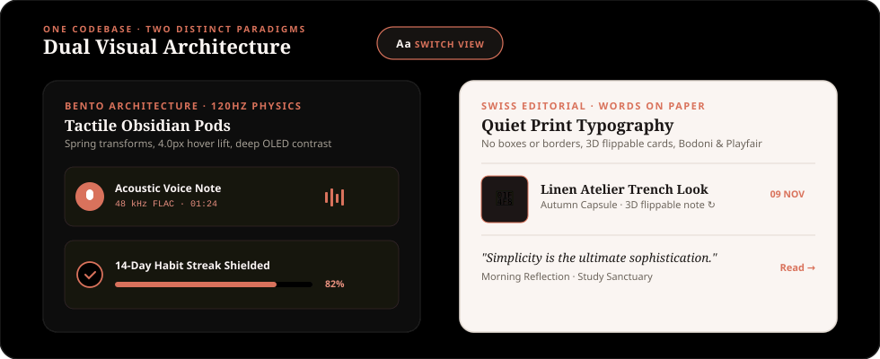

<div align="center">

<!-- LIVE HERO APP SHOWCASE -->
<a href="https://github.com/Allen73737/NOTtEodo">
  
</a>

<br/><br/>

# Notteodo

### *Notes · Tasks · Habits · Expenses · Wardrobe · Moodboards · Audio Studio*
#### **The Aesthetic Personal Sanctuary & Life Suite**

<p align="center">
  <em>One distraction-free sanctuary for your thoughts, daily routines, personal spending, and aesthetic inspiration.</em>
</p>

<!-- DYNAMIC BRAND SHIELDS (STRICT ZERO BLUE · ZERO GOLD · ZERO GREEN) -->
<p align="center">
  <a href="https://flutter.dev"></a>
  <a href="https://dart.dev"></a>
  <a href="#-the-notteodo-palette"></a>
  <a href="#-the-notteodo-palette"></a>
  <a href="#-duolingo-style-animated-notifications"></a>
  <a href="#-aesthetic-pinterest-homescreen-widgets"></a>
  <a href="https://github.com/Allen73737/NOTtEodo/actions"></a>
  <a href="#-license"></a>
</p>

<!-- REAL-TIME HIGHLIGHTS TICKER -->
<p align="center">
  <code>✦ 100% LOCAL-FIRST</code> &nbsp;•&nbsp;
  <code>🔄 DUAL BENTO &amp; SWISS EDITORIAL</code> &nbsp;•&nbsp;
  <code>🎙️ NATIVE AUDIO STUDIO</code> &nbsp;•&nbsp;
  <code>⚡ OMNI-CAPTURE HUB</code> &nbsp;•&nbsp;
  <code>📳 3D FLIP MICRO-HAPTICS</code> &nbsp;•&nbsp;
  <code>📱 LAUNCHER SHORTCUTS</code> &nbsp;•&nbsp;
  <code>🎨 MATERIAL YOU ICON</code> &nbsp;•&nbsp;
  <code>🔒 ZERO SUBSCRIPTIONS</code>
</p>

<br/>

[Overview & Abstract](#-about-notteodo) •
[Why Notteodo?](#-why-notteodo) •
[Dual Visual Architecture](#-dual-visual-architecture-bento--swiss-editorial) •
[Market-Leading Features](#-market-leading-productivity-suite) •
[Native Audio Studio Engine](#-native-android-audio-studio-engine) •
[Duolingo-Style Notifications](#-duolingo-style-animated-notifications) •
[Nodo AI Companion](#-nodo-ai-companion--personality) •
[Pinterest Homescreen Widgets](#-aesthetic-pinterest-homescreen-widgets) •
[Android System-Level Integrations](#-android-system-level-integrations) •
[Core Life Modules](#-core-life-modules) •
[Help, Privacy & Settings](#-help-privacy--settings-subpages) •
[Admin Dashboard & Controls](#-built-in-admin-dashboard) •
[The Color Palette](#-the-notteodo-palette) •
[Quickstart Runbook](#-quickstart-guide) •
[License](#-license)

<br/>


</div>

<br/>

## 📖 About Notteodo

> *"Make space for what matters."*

**Notteodo** is a free, beautifully engineered personal life sanctuary built with Flutter and Dart. It unifies your notes, priority checklists, habit streaks, personal finances, wardrobe curation, and Pinterest-style visual moodboards into one fast, private, distraction-free app.

Whether you're jotting down lightning-fast thoughts with natural-language dates, organizing your week, splitting group dinner expenses with friends, planning your seasonal outfit capsules with instant photo previews, recording high-fidelity voice memos, or checking your daily goals right from your Android home screen, Notteodo makes everyday organization feel calm, tactile, and rewarding.

---

<br/>

## 💡 Why Notteodo?

Modern productivity apps have become cluttered, bloated, and full of monthly paywalls:

| The Old Way | The Notteodo Sanctuary Way |
| :--- | :--- |
| **5 to 10 disconnected apps** (one for notes, one for to-dos, another for budgeting, another for habits) | **One cohesive, beautiful dashboard** where all your daily routines live together seamlessly |
| **Pricy monthly subscriptions** leasing your own thoughts and lists back to you | **100% Free & Open Source** forever — no paywalls, no tiers, no locked features |
| **Cloud surveillance & trackers** scanning your personal entries for targeted ads | **Offline-first privacy** — your data lives safely on your device with military-grade AES-256 GCM encryption |
| **Sterile corporate grey grids** and overwhelming dopamine notifications | **Tuscan warmth & Swiss print aesthetic** with warm porcelain cream, pure OLED pitch black, Breguet focus dials, and warm terracotta accents |
| **Monolithic, locked-in UI design** forcing one view onto every user | **Dual Visual Architecture** — switch effortlessly between tactile 120Hz Bento Cards and Swiss Editorial print typography |

---

<br/>

<div align="center">

</div>

<br/>

## 🔄 Dual Visual Architecture: Bento & Swiss Editorial

Notteodo is built from the ground up on a dual-paradigm presentation engine. A single tap on the **`Aa`** switcher button anywhere in the app instantly transforms the viewport between two distinct aesthetic worlds:

<div align="center">
  
</div>

<br/>

<div align="center">

| Aesthetic Characteristic | 🍱 Bento Architecture (Cards Mode) | 📰 Swiss Editorial (Print Mode) |
| :--- | :--- | :--- |
| **Visual Metaphor** | Physical obsidian deck of cards with depth and chamfers | Fine stationery, Kinfolk magazine, and Swiss editorial print |
| **Layout Philosophy** | High-contrast bento pods with tactile rounded containers | Flush typography on paper; no boxes, borders, or redundant pills |
| **Motion Physics** | **120Hz Spring Dynamics:** 0.975 tactile depression, 4.0px hover lift | **Calm Page Turns:** Gentle opacity dissolves and 3D card flips |
| **Moodboard Visuals** | 3D Polaroid flip cards with handwritten notes on the back | Interactive 3D flippable photo cards (`setEntry(3, 2, 0.001)`) |
| **Wardrobe Previews** | High-resolution garment grid with season & fabric swatches | Clean list rows with 52×52 rounded chamfer thumbnails on the outside |
| **Typography Hierarchy** | Large, legible `13.5–15sp` body text with DM Sans & Space Grotesk | High-fashion Bodoni Moda, literary Playfair Display, and DM Sans |
| **In-App Toast Alerts** | Animated floating bento card with pulsing mascot aura glow | Quiet, book-weight Swiss print card with hairline terracotta line |
| **Where to Switch** | Top App Bar, Hamburger Drawer, Settings, Admin Dashboard, and Sign-In Screen (`Aa` pill) | Top App Bar, Hamburger Drawer, Settings, Admin Dashboard, and Sign-In Screen (`Aa` pill) |

</div>

---

<br/>

<div align="center">

</div>

<br/>

## 🚀 Market-Leading Productivity Suite

Notteodo combines world-class personal organization capabilities designed to outperform bloated mainstream tools while keeping your workflow private, tactile, and calm:

<div align="center">

| Feature | What It Does | Why It Elevates Your Workflow |
| :--- | :--- | :--- |
| **⚡ Omni-Capture Speed Hub** | Universal quick-capture modal (`OmniCaptureModal`) with on-device natural language parsing (`NlpDateParser`). | Type `"Dinner with Sarah $45 tomorrow at 7pm #dining"` and Notteodo automatically extracts the amount, due date, category, and tags, routing it to Notes, Tasks, Habits, or Expenses in seconds. |
| **📳 Mid-Flip Micro-Haptics** | Real-time perspective animation listener tracking the exact $90^\circ$ midpoint ($t = 0.5$) of card rotations. | Provides an authentic physical "card snap" tactile click in your hand as 3D moodboard images and Polaroid pins flip to reveal personal notes. |
| **🔥 14-Week Habit Heatmap** | 98-day continuous activity matrix (`HabitHeatmapWidget`) displaying real-time daily consistency. | Inspired by GitHub commit graphs, giving you an honest, motivating, high-level bird's-eye view of your habit discipline across months. |
| **🏺 Curator's Cabinet** | 8 collectible antique horological milestone badges (`CuratorsCabinetWidget`). | Earn tangible achievements (*Kindling Spark*, *Brass Lantern*, *Sacred Hearth*, *Supernova Corona*, *Golden Phoenix*, *Watchmaker Apprentice*, *Master Horologist*, *Vault Guardian*) with celebratory haptics. |
| **🕯️ Evening Zen Review** | Mindful daily shutdown ritual dialog (`EveningZenReviewDialog`). | Closes open mental loops by reviewing today's completed tasks, celebrating streaks, prompting a 1-sentence gratitude reflection, and sealing the day with an animated wax seal stamp (`WaxSealStamp`). |
| **🔍 Universal Spotlight Search** | Instant global search overlay (`UniversalSearchDialog`) triggered via `Ctrl/⌘ + K` or the search icon. | Real-time cross-module search indexing Notes, Tasks, Habits, Expenses, and Wardrobe with quick category pills and deep 1-tap navigation. |
| **📊 7-Day Expense Pacing Graph** | Visual spend velocity graph (`ExpensePacingGraphWidget`) benchmarked against daily budget limits. | Compares everyday spend against your budget baseline, paired with proactive, friendly companion commentary from Nodo and top category breakdowns. |
| **⏰ Daily Flow Time-Blocking** | 24-hour visual schedule timeline (`DailyFlowTimelineWidget`). | Maps your open tasks to mindful 2-hour rhythm intervals and provides a 1-tap `⚡ FOCUS` button to jump straight into the Watchmaker Focus Dial. |

</div>

---

<br/>

<div align="center">

</div>

<br/>

## 📱 Android System-Level Integrations

Notteodo is engineered as a first-class citizen on modern Android devices, leveraging system capabilities for effortless access:

<div align="center">

| System Feature | Technical Implementation | Practical Daily Benefit |
| :--- | :--- | :--- |
| **⚡ Launcher Quick Shortcuts** | Declared in `shortcuts.xml` and wired via deep links (`notteodo://shortcut/*`) | Long-press the NOTtEodo icon on your Android home screen to immediately trigger **Quick Capture**, **Voice Memo**, or **Focus Timer** without waiting. |
| **🎨 Themed Material You Icon** | Monochromatic vector squircle defined in `mipmap-anydpi-v26/ic_launcher.xml` | Automatically adapts to your Android 13+ wallpaper dynamic color palette when system "Themed Icons" are enabled. |
| **📳 Precision Micro-Haptics** | Native haptic pulses (`HapticFeedback.selectionClick()` & `lightImpact()`) | Delivers tactile feedback when completing tasks, tuning dials, and flipping 3D Polaroid moodboards. |
| **📅 Native Calendar Integration** | Multi-tier Android `CalendarContract` intent insertion | Adds events and reminders directly into Google Calendar with start/end timestamps and descriptions prefilled. |

</div>

---

<br/>

<div align="center">

</div>

<br/>

## 🎙️ Native Android Audio Studio Engine

Voice memos in Notteodo are built on a high-fidelity native Android audio engine engineered directly in `MainActivity.kt` and `voice_studio_modal.dart` without external UI popups or cloud dependencies:

- **Hardware AAC Recording:** High-fidelity audio encoding to `.m4a` files using Android's native `MediaRecorder` with adaptive bitrates.
- **Built-in Audio Playback:** Listen back to your voice notes directly inside the app with Android `MediaPlayer`, complete with play/pause toggles, seek scrubbing, and real-time waveform visualization.
- **Background Speech-to-Text:** On-device voice transcription via Android `SpeechRecognizer` running quietly in the background with **ZERO intrusive Google UI popups or dialogs**.
- **1-Tap Workflow Conversion:** Instantly convert voice memos into structured notes or action items with transcription copy and local audio playback controls.

---

<br/>

<div align="center">

</div>

<br/>

## 🔔 Duolingo-Style Animated Notifications

Notteodo reimagines productivity notifications with playful, visually addictive, Duolingo-style graphics that keep you engaged and protect your daily momentum:

<div align="center">

| Component | Visual & Interactive Character | Technical Implementation |
| :--- | :--- | :--- |
| **🔥 Native Dynamic Mascot** | 128×128 circular canvas badge with warm terracotta radial gradient and emoji mascot (`🔥` for streak, `🦉` for Nodo) | Android native `createMascotLargeIcon()` in `NotificationReceiver.kt` |
| **⚡ 1-Tap Shade Actions** | Direct action buttons inside the Android shade: `"🔥 Check In"` to save daily streak or `"⚡ Focus 25m"` to launch Pomodoro timer | Intent extras dispatched directly into Flutter via MethodChannels |
| **🦉 In-App Floating HUD** | Tactile floating banner with animated breathing aura glow, bobbing mascot avatar (`🔥`, `🦉`, `⚡`, `🛡️`), and spring bounce entrance (`Curves.easeOutBack`) | Custom `SanctuaryAnimatedNotificationCard` with `TickerProviderStateMixin` |
| **⏳ Depleting Progress Line** | Smooth dual-gradient progress countdown bar running along the bottom border showing exact remaining notification lifetime | Reactive `AnimationController` binding (`widget.lifeController`) |
| **⏰ User-Configurable OS Cadence** | User-customizable notification intervals (1h, 2h, 3h default, 4h, 6h, 12h, or Once Daily) triggering smart reflection prompts, focus sprints, and streak shields | Android `AlarmManager.AlarmClockInfo` + dynamic `DailyEngagementService` scheduling |
| **🌍 Global Timezone Adaptation** | Seamless local wall-clock delivery (09:30 Morning Briefing & 21:30 Evening Zen Daily Recap) across any location (IST, EST, GMT, JST) | Auto-detects device timezone; `NotificationReceiver` listens for `ACTION_TIMEZONE_CHANGED` on travel |

</div>

---

<br/>

<div align="center">

</div>

<br/>

## 🦉 Nodo AI Companion & Personality

Notteodo features **Nodo**, an empathetic, on-device AI companion designed to feel like a thoughtful partner rather than a sterile chatbot:

- **Context-Aware Memory:** Automatically synchronizes with your profile display name, bio motto, active habit streaks, and pending tasks so every response feels personal.
- **Dual Companion Modes:**
  - 🌟 **"Inspire Me":** Philosophical, calming maxims designed to re-center your attention and ground your daily intentions.
  - 🔥 **"Roast My Focus":** Witty, affectionate, tough-love reality checks that push you to stop over-planning and conquer your top open priority right now.
- **Autonomous Note-to-Workflow:** Intelligently extracts actionable tasks and financial disbursements from unstructured notes.
- **Weekly Executive Dossier:** Synthesizes cross-module velocity into a clean executive summary every week.

---

<br/>

<div align="center">

</div>

<br/>

## 📌 Aesthetic Pinterest Homescreen Widgets

Bring the cozy, aesthetic vibe of Notteodo directly onto your phone's home screen. With our built-in **Interactive Widget Studio**, you can preview, customize, and pin 8 distinctive home screen widgets on Android and iOS in both **Bento** and **Swiss Editorial** styles:

<div align="center">

| Widget Type | What it Shows | Aesthetic Details |
| :--- | :--- | :--- |
| 📝 **Sticky Note & Memo** | Latest thought, pinned note excerpt, or quote | Textured paper card, serrated washi tape strip, editorial Bodoni title |
| ✅ **Daily Ritual Checklist** | Top tasks due today + habit streak progress | Checkbox progress counter (`4/5 DONE`), strikethrough typography |
| 🖼️ **Polaroid Inspiration Pin** | Highlighted image from your moodboards | Authentic Polaroid white photo border with handwritten italic caption |
| 👗 **Outfit of the Day** | Current season look, silhouettes, and fabric swatches | Clean editorial layout, temperature indicator, and palette dots |
| 💰 **Treasury & Budget Meter** | Monthly spend pacing and today's outflows | Minimal cash meter, currency symbol, and burn rate progress bar |
| 🎙️ **Voice Note Memo** | Quick voice note title, audio waveform, and duration | Retro cassette tape reels with red recording indicator |
| ✈️ **Travel Boarding Pass** | Next trip destination and departure countdown | Perforated airline ticket border with airport code route (`CDG ✈ HND`) |
| ⏱️ **Focus Clock & Quote** | Live system time + rotating daily reflection prompt | Classic horological dial with clean typography |

</div>

> [!TIP]
> Open the in-app **Widget Studio** anytime from **Settings $\rightarrow$ Homescreen Widget Studio** to preview paper styles, choose washi tape colors, and toggle between Bento and Swiss Editorial widget styling.

---

<br/>

<div align="center">

</div>

<br/>

## 🌌 Core Life Modules

Notteodo is organized into cohesive spaces so you can navigate your day effortlessly:

```
┌─────────────────────────────────────────────────────────────────────────────────┐
│                                NOTTEODO DASHBOARD                               │
├─────────────────────┬─────────────────────┬─────────────────────┬───────────────┤
│  01. HOME SANCTUARY │  02. SMART NOTES    │  03. TASKS & HABITS │  04. EXPENSES │
│  Daily Overview     │  Rich Markdown & AI │  Priority Checklist │  Personal &   │
│  & Morning Briefing │  Media Attachments  │  Streak Habit Rings │  Group Splits │
├─────────────────────┼─────────────────────┼─────────────────────┼───────────────┤
│  05. WARDROBE       │  06. MOODBOARDS     │  07. TRAVEL SPACES  │  08. ADMIN    │
│  Outfit Planner &   │  Pinterest Masonry  │  Packing Lists &    │  System       │
│  Thumbnail Previews │  3D Flip Note Cards │  Itinerary Passports│  Control Room │
└─────────────────────┴─────────────────────┴─────────────────────┴───────────────┘
```

1. **Home Sanctuary & Morning Briefing:** A serene morning overview displaying your top priorities, active habit streaks, planned outfit, and budget pacing without any stressful clutter.
2. **Watchmaker Focus Dial:** Swiss horology-inspired Pomodoro dial with animated Breguet hands sweeping over an ivory chapter ring with custom ambient soundscapes.
3. **Notes & Documents:** Clean markdown writing with rich formatting, document tags, photo attachments, and a grounded AI assistant that answers questions directly from your own notes.
4. **Tasks & Habits:** Keep track of urgent to-dos and daily habits. Build positive streaks through 5 evolutionary flame tiers.
5. **Expenses & Bill Splitting:** Log everyday expenses, track monthly budgets, and easily calculate fair group splits with friends without needing a separate split app.
6. **Wardrobe & Outfits:** Catalog your clothes, build seasonal outfit pairings, and plan what to wear with direct external list thumbnails.
7. **Moodboards & Aesthetics:** Infinite visual pinboards featuring 3D flippable card notes with mid-flip micro-haptics.
8. **Travel & Trips:** Trip planners with flight itinerary cards, packing matrices, and shared travel spending ledgers.

---

<br/>

<div align="center">

</div>

<br/>

## ⚙️ Help, Privacy & Settings Subpages

Every category in the Settings screen expands into an interactive, dedicated subpage:

- **❓ Help & Support (`HelpSupportSubpage`):**
  - **18 Comprehensive FAQs** covering streaks, vault PINs, timer soundscapes, budget burn rates, calendar exports, and sync.
  - **Real-Time Search & Category Filters:** Live text filtering and category pills (*Streaks & Habits*, *Privacy & Security*, *AI Companion*, *Focus & Timer*, *Backup & Sync*, *Budget & Expenses*).
- **🛡️ Privacy & Data Safety (`PrivacySafetySubpage`):**
  - **100% Local-First Transparency:** Transparent audit showing local SQLite encryption, opt-in cloud sync, and 0 third-party tracking SDKs.
  - **Complete Data Ownership Controls:** Instant 1-tap "Export Full Archive (JSON)", "Clear Temporary Cache", and "Permanently Erase All Data" with verification safeguards.
- **🎨 Look & Feel Customization (`LookAndFeelPage`):**
  - **Curated Headline Typography:** Choose between **Bodoni Moda** *(Classic)*, **Playfair Display** *(Literary)*, **DM Sans** *(Modern)*, and **Space Grotesk** *(Technical)*.
  - **Display Densities:** Compact, Comfortable, or Airy row spacing.
- **🔔 Notifications & Cadence (`NotificationsSettingsSubpage`):**
  - **User-Configurable On-Device Cadence:** Choose from `1h`, `2h`, `3h (Balanced Default)`, `4h`, `6h`, `Twice Daily (12h)`, or `Once Daily (24h)` intervals.
  - **Intelligent Quiet Hours & Briefing Sync:** Automatically respect sleep windows and space daytime triggers harmoniously.
- **👑 Built-in Admin Dashboard:**
  - Full server-side lockdown via `public.app_admins` table and RLS policies.
  - Dual Bento/Editorial display switch with real infrastructure telemetry and zero dummy data.

---

<br/>

<div align="center">

</div>

<br/>

## 🎨 The Notteodo Palette

Notteodo's visual design is strictly free of corporate blues, harsh cyans, bright greens, and loud yellows or golds. It transitions seamlessly between **Terracotta-Infused Porcelain White** (`#FAF5F2`) for daylight clarity and **Pure Pitch Black OLED** (`#000000`) with obsidian surfaces for nighttime focus.

<div align="center">
  
</div>

<br/>

<div align="center">

| Color Token | Hex Code | Visual Character & App Role |
| :--- | :---: | :--- |
| `AppColors.darkBackground` | `#000000` | **Pitch Black OLED:** True 100% black pixels for battery saving and night comfort |
| `AppColors.darkSurfaceHigh` | `#0A0A0A` | **Obsidian Charcoal:** High-contrast solid dark surfaces for bento cards |
| `AppColors.darkBorder` | `#1E1E1E` | **Titanium Hairline:** Subtle, clean card borders in dark mode |
| `AppColors.onSurface` | `#1D1C15` | **Warm Charcoal Ink:** Editorial typography for daylight reading |
| `AppColors.background` | `#FAF5F2` | **Terracotta Porcelain White:** Warm white infused with subtle terracotta glow |
| `AppColors.secondary` | `#D9725B` | **Terracotta Red:** Primary buttons, active tabs, and completed checkmarks |
| `AppColors.goldPrimary` | `#D9725B` | **Warm Terracotta:** Executive accents, focus dials, and admin badges (zero yellow/gold) |
| `AppColors.themePlanner` | `#D9725B` | **Warm Terracotta:** Habit streaks, calm productivity lanes, and calendar milestones |
| `AppColors.themeExpenses` | `#C87A5B` | **Terracotta Clay:** Expense categories, budget meters, and treasury balances |
| `AppColors.themeSplitter` | `#C88552` | **Warm Sienna:** Group debt settlement cards and shared expenses |
| `AppColors.themeJournal` | `#C28E8E` | **Dusty Rose:** Personal journal entries and mood reflections |
| `AppColors.themeTravel` | `#9E7B56` | **Antique Saddle Bronze:** Travel passports, departure cards, and packing lists |

</div>

---

<br/>

<div align="center">

</div>

<br/>

## 🛠️ Quickstart Guide

### Prerequisites
- **Flutter SDK:** `3.24` or newer ([Install Flutter](https://docs.flutter.dev/get-started/install))
- **Dart SDK:** `3.5` or newer
- **Browser, Android Device / Emulator, or iOS Simulator**

### 1. Clone & Setup
```bash
# Clone the repository
git clone https://github.com/Allen73737/NOTtEodo.git
cd NOTtEodo

# Configure your local environment variables
cp .env.example .env
```

### 2. Run the App
```bash
# Move to the Flutter frontend directory
cd frontend

# Install dependencies
flutter pub get

# Run on Chrome / Web
flutter run -d chrome

# Or run on Android / iOS
flutter run -d android
flutter run -d ios
```

### 3. Verification & Testing
```bash
# Run strict static code analysis (0 errors, 0 warnings, 0 infos)
dart analyze lib test --fatal-infos

# Run the complete test suite (245 passing tests across all modules)
flutter test
```

---

<br/>

<div align="center">

</div>

<br/>

## ⚖️ License

Distributed under the **MIT License**. See [LICENSE](LICENSE) for full details.

<br/>

<div align="center">

```
  ✦ · ✦ · ✦
  "Make space for what matters."
  Notteodo · Notes · Tasks · Habits · Expenses · Wardrobe · Moodboards · Life
```


</div>
